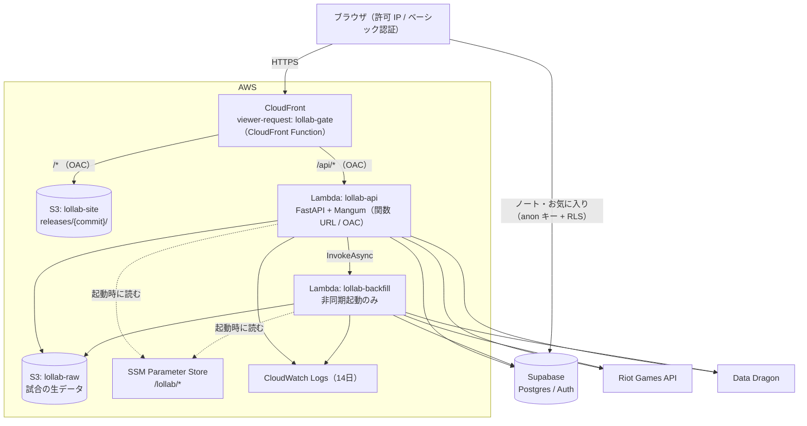
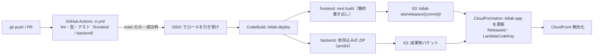

# 設計書: AWS 移行

## 概要

画面（静的ファイル）と API（Lambda）を1つの CloudFront の下にまとめ、入口を CloudFront だけにする。DB は Supabase のまま。リージョンは `ap-northeast-1`（CloudFront は全世界、Budgets は請求の仕組み上グローバル）。

すべて Always_Free の範囲で動かす。VPC・NAT Gateway・常時起動のサーバー・Provisioned Concurrency・AWS WAF・Secrets Manager は使わない。

## システム構成



- ノート・お気に入りはこれまでどおりブラウザから Supabase を直接読み書きする（RLS で本人のデータだけ）。第1段階の制限は掛からないが、第2段階と同じく本人のログインが必要で、他人のデータには触れられない
- API は同じオリジン（`/api/*`）で呼ぶため CORS は不要になる

## フロントエンド

### 静的書き出し

- `next.config.ts`: `output: 'export'`、`trailingSlash: true`（`/champion/Ahri/index.html` の形で出力）、`images.unoptimized: true`
- `/champion/[championName]`: `generateStaticParams` で `champions.ts` の全 ID を事前生成する（`dynamicParams = false`）。クエリ（`role`・`period`・`queue`）は静的書き出しではサーバーで読めないため、`ChampionBuildFromUrl`（`useSearchParams` を `Suspense` で囲む）がブラウザで読む。統計はこれまでどおりブラウザで API から取得する
- `app/auth/callback/route.ts`（サーバー処理）を削除し、`app/auth/callback/page.tsx`（クライアント）でブラウザ用 Supabase クライアントの `exchangeCodeForSession(code)` を呼んでトップへ遷移する
- API の呼び出し先: `NEXT_PUBLIC_BACKEND_URL` の既定を空文字（同じオリジン）にし、パスは `/api/...` のまま。ローカル開発は `http://localhost:8000` を設定する
- 404: `app/not-found.tsx` を `404.html` として出力する（CloudFront での返し方は下記「エラー応答」）

### ログインと許可ユーザー

- `AuthGate`（クライアント）を `layout.tsx` に置き、未ログインならログイン画面だけを表示する。API が 403 を返したら「このアカウントでは利用できません」を表示する（`/auth/callback` は対象外）
- `NEXT_PUBLIC_AUTH_GATE_ENABLED=false` でログイン画面の強制を無効にできる（ビルド時の設定。一般公開時は CodeBuild の環境変数を変えて再ビルドする）。403 の表示は無効時も維持する
- すべての API 呼び出しに、Supabase のアクセストークンを `X-Lollab-Auth: Bearer <token>` ヘッダーで付ける
  - `Authorization` ヘッダーは使わない。ベーシック認証と、CloudFront → Lambda の OAC 署名が `Authorization` を使うため
- `POST` など本文のあるリクエストは、本文の SHA-256 を `x-amz-content-sha256` ヘッダーに付ける（Lambda 関数 URL の OAC の仕様）。本文のない `POST /update` も空文字のハッシュを付ける
- `lib/api/request.ts` に共通の `apiFetch` を作り、上の2つのヘッダーをここでまとめて付ける

## CloudFront

| ビヘイビア | オリジン | キャッシュ | 備考 |
|---|---|---|---|
| `/api/*` | Lambda 関数 URL（OAC、`AWS_IAM` 認証） | 無効（CachingDisabled） | オリジンリクエストポリシーで `X-Lollab-Auth`・クエリを転送。`Authorization` は転送しない。`x-amz-content-sha256` はポリシーに書けず（CloudFront が拒否）、OAC の署名で CloudFront が扱う |
| `/_next/static/*` | S3（OAC） | 1年 | ファイル名にハッシュが付くため長期キャッシュ |
| `/*`（既定） | S3（OAC）、オリジンパス `/releases/{commit}` | 短め（5分） | |

- エラー応答: 当面は設定しない。存在しない URL は S3 のエラー（403、XML）がそのまま返る。一般公開時（SEO 対応）に作り直す
  - ディストリビューションの CustomErrorResponses は `/api/*` の 403・404（許可外のメール、サモナー未発見）まで置き換えるため使えない
  - viewer-response の CloudFront Function は、オリジンが 400 以上を返すと実行されないため使えない
- 価格クラス: `PriceClass_200`（日本を含む）。ログは標準ログを使わない（料金と量を抑える）

### アクセスゲート（CloudFront Function `lollab-gate`、viewer-request、全ビヘイビア）

1. `GATE_ENABLED` が false なら判定を省略する
2. `event.viewer.ip` が許可 IP（IPv4・IPv6 の CIDR の並び）に含まれれば通す
3. `Authorization: Basic ...` の値の SHA-256 が、設定したハッシュと一致すれば通す（パスワードは関数コードに平文で置かない）
4. どちらでもなければ 401 と `WWW-Authenticate: Basic realm="LoL Lab"` を返す
5. 通したリクエストのうち `/api/` 以外で拡張子のないパスは `{path}/index.html` に書き換える（静的書き出しの URL 対応）

- 許可 IP・ハッシュ・有効／無効は CloudFormation のパラメータで渡し、関数コードに埋め込んで発行する（スタックの更新だけで変更でき、アプリのコードは変えない）。CloudFront KeyValueStore は有料のため使わない
- 1つのビヘイビアに viewer-request 関数は1つしか付けられないため、ゲートと URL 書き換えを同じ関数にする

## バックエンド

### Lambda 関数

| 関数 | 起動 | タイムアウト | メモリ | 備考 |
|---|---|---|---|---|
| `lollab-api` | CloudFront（関数 URL、OAC） | 29秒 | 512MB | `handler = Mangum(app, lifespan="auto")`。Python 3.12、arm64 |
| `lollab-backfill` | `lollab-api` からの非同期起動のみ（関数 URL なし） | 300秒 | 512MB | 非同期起動の再試行は0回 |

- 同じ ZIP（`backend/` の全コードと依存。arm64 の manylinux aarch64 の wheel でビルドし、テスト用の `moto` などは含めない）を両方の関数で使い、ハンドラーだけを分ける（`lambda_handlers/api.py`、`lambda_handlers/backfill.py`）
- `BackgroundTasks.add_task(run_backfill, ...)` は、`services/summoner/backfill_dispatch.py` の `dispatch_backfill(region, puuid)` に置き換える（シグネチャは `dispatch_backfill(background_tasks, region, puuid)`）。Lambda 上では `lambda:InvokeFunction`（`InvocationType=Event`）、ローカルではこれまでどおり BackgroundTasks で実行する（`BACKFILL_MODE=lambda|inline`、既定 inline）。起動に失敗しても API の応答は失敗させずログに残す
- `run_backfill` に締め切り（`deadline`）を渡し、残り時間が30秒を切ったらページの区切りで終了する（カーソルは保存済みページまで進む。要件2.5）

### Backfill の同時実行の制限

新しい AWS アカウントは同時実行数の上限が小さく、予約同時実行数を設定できない場合があるため、DB のリース（貸し出し）で制限する。

- `worker_leases` テーブル（`name` PK、`holder`、`expires_at`）を追加する（database Spec を更新）
- `lollab-backfill` は開始時に `name = 'riot-backfill'` のリースを1回の UPDATE で取得する（期限切れなら取得できる。期限は締め切り + 60秒）。取得できなければ何もせず終了する
- 取得できなかったサモナーの Backfill は、次回の検索・更新で続きから行われる（既存のカーソルの仕組み）
- 既存のサモナー単位のロック（`backfill_started_at`）はそのまま残す

### 認証（第2段階）

- `api/deps/auth.py` の依存関数 `require_allowed_user` を全ルーター（`/api/summoner`、`/api/champion`、`/api/favorites`）に付ける
- `X-Lollab-Auth` の JWT を、ヘッダーの `alg` に応じて検証する（現在のプロジェクトは JWKS が空で、共有シークレットの HS256 方式）
  - `ES256` / `RS256`: Supabase の JWKS（`https://{ref}.supabase.co/auth/v1/.well-known/jwks.json`）の公開鍵で検証する。JWKS はメモリに10分キャッシュし、未知の `kid` が来たら取り直す（不正な `kid` の連打で Supabase を叩き続けないよう、取り直しは30秒に1回まで）
  - `HS256`: JWT シークレット（SSM の `/lollab/supabase_jwt_secret`）が設定されている場合だけ、そのシークレットで検証する。未設定なら拒否する
  - それ以外の `alg`（`none` など）は拒否する。公開鍵を HS256 のシークレットとして使う取り違えが起きないよう、`alg` ごとに検証方法を固定する
- 非対称鍵への移行は Supabase 側の操作だけで済む。移行後、JWT シークレットのパラメータを削除すれば HS256 は受け付けなくなる（コード変更なし）
- HS256 は、シークレットが漏れると任意の利用者のトークンを偽造できる（第2段階を突破できる）点で、公開鍵で検証する方式より弱い。シークレットは SecureString で `lollab-api` だけが読めるようにする
- 検証に失敗したら 401、メールアドレスが許可一覧にない場合は 403
- `USER_GATE_ENABLED=false` で判定を省略する（審査期間・一般公開時。要件5.8・5.9）。`/api/favorites` は省略時も本人のログインを要求する（既存の挙動）

### 設定と秘密情報

起動時に SSM Parameter Store から読み、環境変数に設定してから `Settings` を作る（`config.py` に `load_ssm_parameters(path)` を追加。`SSM_PARAMETER_PATH` が未設定のローカルでは `.env` を使う）。

| パラメータ | 型 | 読める関数 |
|---|---|---|
| `/lollab/riot_api_key` | SecureString（`aws/ssm` キー） | api, backfill |
| `/lollab/supabase_key` | SecureString | api, backfill |
| `/lollab/supabase_url` | String | api, backfill |
| `/lollab/allowed_emails` | StringList | api |
| `/lollab/supabase_jwt_secret` | SecureString（任意。HS256 の検証用） | api |

- SecureString は CloudFormation で作れないため、初回に CLI で登録する（手順は `docs/architecture.md`）
- 関数の環境変数には秘密でない設定だけを置く
  - `lollab-api`: `SSM_PARAMETER_PATH=/lollab/`、`RIOT_RATE_LIMITS`、`USER_GATE_ENABLED=true`、`BACKFILL_MODE=lambda`、`BACKFILL_FUNCTION_NAME`、`RAW_BUCKET`、`SUPABASE_PROJECT_REF`
  - `lollab-backfill`: `SSM_PARAMETER_PATH=/lollab/`、`SSM_PARAMETER_NAMES=riot_api_key,supabase_key,supabase_url`、`RIOT_RATE_LIMITS`、`RAW_BUCKET`
- SSM の読み取り: `SSM_PARAMETER_NAMES` が無ければ `ssm:GetParametersByPath` で `/lollab/` 配下をまとめて取得する（api）。あれば `ssm:GetParameters` で指定した名前だけを読む（backfill。ByPath の権限はパス単位でしか絞れないため）。どちらも OS の環境変数だけを見る（`.env` では有効にならない）
- 許可メールの一覧が空の場合は全員を拒否する

### Riot API のレート制限の分け合い

各関数のプロセス内で数える既存の仕組みを使い、関数ごとに上限を割り当てる。合計はキーの上限（Personal: 20:1,100:120）以内にする。

| 関数 | `RIOT_RATE_LIMITS` | `RIOT_BACKFILL_RESERVE_RATIO` | 根拠 |
|---|---|---|---|
| `lollab-api` | `8:1,50:120` | `0` | 初回登録は最大約45回 |
| `lollab-backfill` | `10:1,45:120` | `0` | 別関数なので予約は不要 |

- `lollab-api` は同時に複数動くことがあり、その場合は上限を超えうる。自分1人の利用では実質起きないため許容する（Riot の 429 は既存の処理でエラー表示になる）
- Production キーへの切り替えやクローラー追加時は、この表を更新する

### 生データの保管

- `adapters/raw_store.py` の保存先を S3（`lollab-raw`、非公開、パブリックアクセスブロック、SSE-S3）に切り替える。パスは現在と同じ `matches/{match_id}/detail.json.gz`・`timeline.json.gz`
- `scripts/migrate_raw_to_s3.py`: Supabase Storage の `riot-raw` の全オブジェクトを S3 にコピーし、件数とサイズを照合してから Supabase 側を削除する（`--dry-run` あり）
- まとめて1ファイルにする形式はクローラーの Spec で扱う

## 構成管理（CloudFormation）

```
infra/
├── bootstrap.yaml   # 初回に手動で1回デプロイ: GitHub OIDC プロバイダー、デプロイ用ロール、成果物バケット、CodeBuild プロジェクト
├── app.yaml         # S3（site・raw）、CloudFront・OAC・CloudFront Function、Lambda 2つ、IAM ロール、ロググループ
└── functions/
    └── gate.js      # CloudFront Function のソース（app.yaml のパラメータを埋め込んでデプロイ）
```

`app.yaml` の主なパラメータ: `ReleaseId`（フロントエンドのコミット）、`LambdaCodeKey`、`GateEnabled`、`AllowedCidrs`、`BasicAuthHash`、`UserGateEnabled`、`ApiRateLimits`、`BackfillRateLimits`

### IAM（最小権限）

| ロール | 許可 |
|---|---|
| `lollab-api` の実行ロール | 自分のロググループへの書き込み、`/lollab/*` の SSM 読み取りと `aws/ssm` の復号、`lollab-raw` の Get/Put、`lollab-backfill` の Invoke |
| `lollab-backfill` の実行ロール | ロググループへの書き込み、`riot_api_key`・`supabase_key`・`supabase_url` だけの `ssm:GetParameters` と復号、`lollab-raw` の Get/Put |
| GitHub Actions のロール（OIDC） | `main` ブランチからの実行に限り、CodeBuild プロジェクトの `StartBuild` と結果の参照だけ |
| CodeBuild のロール | 成果物バケットへの書き込み、`lollab-site` の `releases/*` の Put/Delete、`lollab-app` スタックの更新（CloudFormation のサービスロールを渡す）、CloudFront の無効化 |
| CloudFormation のサービスロール（`lollab-cloudformation-app`） | `app.yaml` のリソースの作成・更新。IAM は `role/lollab-app-*`（CloudFormation の自動命名）に限る |

### コスト

- Budgets: 月 $1 で予測・実績それぞれメール通知（コンソールで作成済み: `lollab-zero-spend`（1セントでも費用が出たら通知）、`My Monthly Cost Budget`（月 $1）。CloudFormation には含めない）
- 無料枠の使用量アラート（請求設定の「無料利用枠の使用アラート」）を有効にする
- ロググループの保存期間: 14日
- `lollab-site` の `releases/` は期限で消さない（長くデプロイしないと配信中のファイルまで消えるため）。デプロイ成功後に CodeBuild が、今回と直前（切り戻し用）以外のリリースを削除する
- CodeBuild は arm1.small（ARM_CONTAINER の SMALL）。無料枠の月100分の対象

## CI/CD



- `ci.yml` の Node.js を 20 以上に上げる（Next.js 16 の要件）。デプロイジョブを追加し、テストジョブの成功後に `aws codebuild start-build` を呼んで完了を待つ
- CodeBuild は `buildspec.yml`（リポジトリ直下）でビルドとデプロイを行う。ソースは GitHub（CodeConnections）からコミットを指定して取得する
- デプロイの切り替えは CloudFormation のパラメータ更新で行う。失敗時はスタックが自動で元に戻り、CloudFront は前のリリースを参照したままになる（要件7.4）
- 想定のビルド時間: 1回 5〜8分、デプロイは `main` へのマージ時だけ（CodeBuild の月100分の無料枠内）

## 移行手順

1. 初回の準備（手作業）: ルートユーザーの MFA、IAM Identity Center のユーザー作成、`bootstrap.yaml` のデプロイ、SSM パラメータの登録、CodeConnections の GitHub 連携
2. `worker_leases` のマイグレーションを本番 DB に適用する
3. `app.yaml` を初回デプロイし、CloudFront の URL で全機能を確認する（ゲートは有効）
4. Supabase Auth のリダイレクト URL に CloudFront の URL を追加する
5. 生データを S3 に移す（`migrate_raw_to_s3.py`）
6. Vercel・Render を停止する（数日様子を見てから削除）。Supabase Auth のリダイレクト URL から Vercel の URL を消す
7. `docs/architecture.md` を作成し、steering（tech.md・structure.md）と各 Spec の Vercel・Render の記述を更新する。本 Spec を削除する

## テスト方針

| 対象 | 内容 |
|---|---|
| `gate.js` | 許可 IP（IPv4・IPv6・CIDR 境界）、ベーシック認証の一致・不一致、無効時、拡張子のないパスの書き換え（Node で関数を読み込んで単体テスト） |
| `require_allowed_user` | 有効な JWT・期限切れ・署名不正・許可外のメール・ヘッダーなし・無効化時 |
| `dispatch_backfill` | `lambda` モードで非同期起動の引数、`inline` モードで BackgroundTasks |
| `run_backfill` の締め切り | 残り時間が少なければページの区切りで終了し、カーソルが保存済みページまで |
| `worker_leases` | 取得・期限切れ後の再取得・取得中の二重起動 |
| `raw_store`（S3） | 保存・読み出し（moto などでモック） |
| フロントエンド | `apiFetch` のヘッダー、`AuthGate` の表示、`/auth/callback` のコード交換 |
| 手動 | 移行手順3で全画面を確認（ゲート有効・無効、許可外 IP、許可外メール） |
