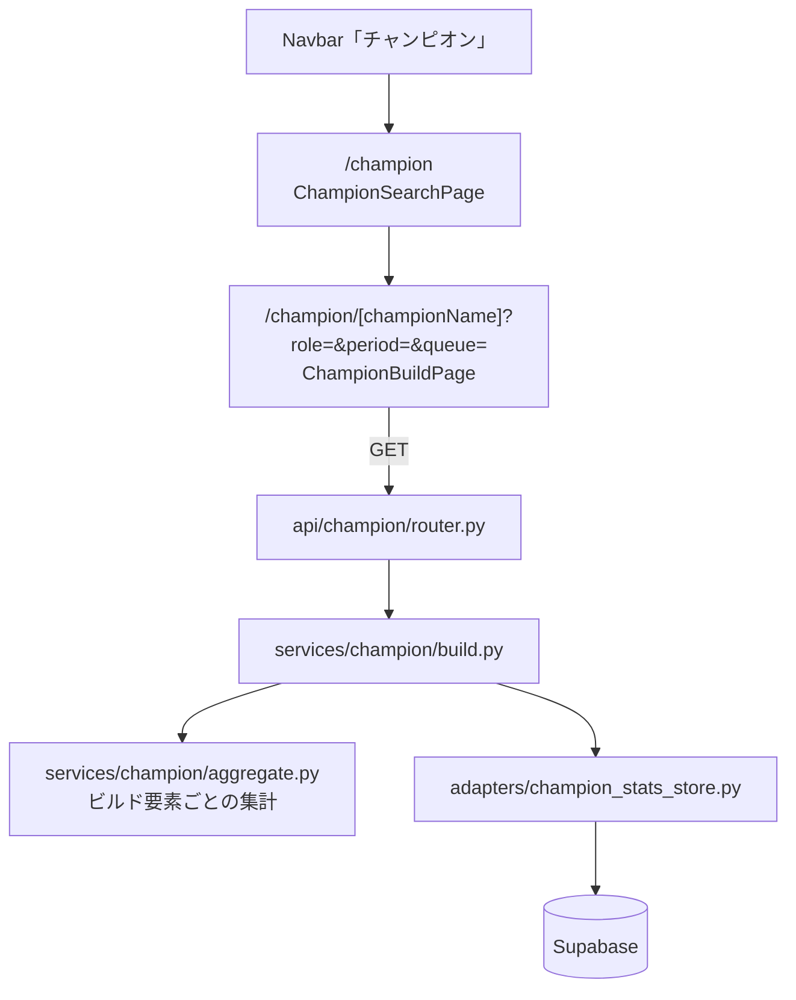
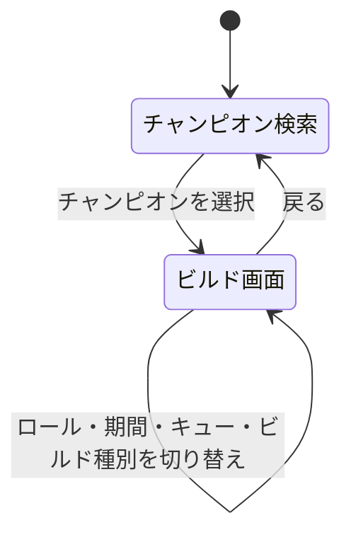

# 設計書: チャンピオンビルド

## 概要

`match_participants` に保存済みの参加者成績を、チャンピオン・ロール・集計期間・キューで絞り込み、ビルド要素ごとに選択肢別の試合数・勝利数を集計して返す。
「最高勝率」と「最多」の切り替えはフロントエンドで行う（API は選択肢ごとの試合数・勝利数を返すだけ）。

使うテーブル: `matches`、`match_participants`、`match_bans`。定義は [database Spec](../database/design.md) を参照。
試合データの取り込み（ルーン・BAN・タイムライン）は [summoner-search-api の design.md](../summoner-search-api/design.md)「試合データの取り込み」を参照。

## システム構成



## 画面遷移



## 集計

### 対象の絞り込み

| 条件 | 内容 |
|---|---|
| チャンピオン | `champion_name`（Data Dragon の ID と同じ。例: `LeeSin`） |
| ロール | `team_position` |
| 集計期間 | 最新パッチ: `patch` が DB 内の最新パッチ / 直近30日: `game_end_at >= now - 30日` / 全期間: 条件なし |
| キュー | 420 / 440 / 両方 |
| 除外 | `is_remake = true` の試合 |

最新パッチは、終了日時が新しい直近50試合のパッチのうち数値として最大のもの（`16.9` < `16.22`）とし、API の応答に含める。DB に試合がなく最新パッチが決まらない場合、`latest_patch` 期間では集計せずに試合数0を返す。

- ピック率・BAN率・全体平均勝率との差は 0〜1 の比率で返す。分母が0なら0
- BAN 率は `champion_id` で数えるため、`champion_name` から `champion_id` を参加記録で引く。参加記録がないチャンピオンの BAN 率は0
- 試合総数・ロール全体の勝率・BAN 数は行を取得せず件数だけ数えるクエリで求める

### 概要の値

| 値 | 計算 |
|---|---|
| 試合数 | 絞り込み後の参加者行数 |
| 勝率 | 勝利数 / 試合数 |
| 全体平均勝率との差 | 勝率 − 同じ期間・キュー・ロールの全参加者の勝率 |
| ピック率 | 試合数 / 同じ期間・キューの試合総数 |
| BAN率 | そのチャンピオンが BAN された試合数 / 同じ期間・キューの試合総数（ロールに依存しない） |

### ビルド要素の選択肢の作り方

| 要素 | 選択肢のキー | 対象外の行 |
|---|---|---|
| スキル優先順 | `skill_order` で Q/W/E がそれぞれ5回目に達した順（例: Q>W>E）。5回に達しないスキルは習得回数の多い順で補う | `skill_order` が NULL |
| スキル順 | `skill_order` の先頭15個 | `skill_order` が NULL または15個未満 |
| サモナースペル | `spell1_id`・`spell2_id` を昇順に並べた組 | なし |
| 開始アイテム | `starting_items` を昇順に並べた組 | `starting_items` が NULL |
| コアビルド | `completed_items` の先頭3つ（順序あり） | 完成アイテムが3つ未満 |
| 4〜6番目のアイテム | `completed_items` の4〜6番目それぞれ（単体） | 該当番目がない |
| ルーン | `primary_style_id`・`primary_perk_ids`・`sub_style_id`・`sub_perk_ids`（サブは昇順）・`stat_perk_ids` の組 | `primary_perk_ids` が NULL |

- 各要素について、選択肢ごとに試合数・勝利数を数え、試合数の多い順に上位10件を返す。最高勝率の選択肢が上位10件に入らない場合に備え、最高勝率の1件も別に返す（同率なら試合数の多い方）
- 集計はサービス層の Python で行う。対象行は必要な列だけをページ単位（1000行）で取得する
- 将来クローラーで試合数が大きく増えたら、集計結果を保存するテーブルや PostgreSQL の関数に移す（API の形は変えない）

## API

| メソッド | パス | 応答 |
|---|---|---|
| GET | `/api/champion/{championName}/build?role=&period=&queue=` | `ChampionBuildResponse` |

- `role`: 省略時はそのチャンピオンの試合数が最も多いロール（同数はロール名の昇順）。試合が0件なら応答の `role` は null
- `period`: `latest_patch`（既定）/ `last_30_days` / `all`
- `queue`: `all`（既定）/ `solo` / `flex`
- `championName` は英数字のみ（1〜30文字）。不正な値は 422。DB に試合がないチャンピオンは 200 で試合数0を返す

### スキーマ（schemas/champion.py）

```python
class BuildOption(BaseModel):
    key: list[int]      # 要素ごとのキー（スキルは 1〜4、アイテム・ルーン・スペルは ID）
    games: int
    wins: int

class BuildElement(BaseModel):
    games: int                      # この要素の集計対象の行数
    options: list[BuildOption]      # 試合数の多い順、最大10件
    best_win_rate: BuildOption | None

class ChampionBuildSummary(BaseModel):
    games: int
    wins: int
    win_rate_delta: float
    pick_rate: float
    ban_rate: float

class ChampionBuildResponse(BaseModel):
    champion_name: str
    role: str | None                # 試合0件でロール省略時は None
    roles: dict[str, int]           # ロール別の試合数（試合数の降順。ロール切り替え用）
    period: str
    queue: str
    latest_patch: str | None
    summary: ChampionBuildSummary
    skill_priority: BuildElement
    skill_order: BuildElement
    spells: BuildElement
    starting_items: BuildElement
    core_items: BuildElement
    item4: BuildElement
    item5: BuildElement
    item6: BuildElement
    runes: BuildElement             # key = [primary_style, p1, p2, p3, p4, sub_style, s1, s2, shard1, shard2, shard3]
```

## コンポーネントとインターフェース

### バックエンド

```
backend/
├── api/champion/router.py
├── services/champion/
│   ├── build.py          # 絞り込み条件の決定・応答の組み立て
│   ├── aggregate.py      # ビルド要素ごとの選択肢集計（純粋関数）
│   └── skill_priority.py # スキル優先順の算出（純粋関数）
├── adapters/champion_stats_store.py
└── schemas/champion.py
```

```python
# adapters/champion_stats_store.py
async def get_latest_patch() -> str | None
async def get_build_rows(champion_name: str, role: str | None, filters: StatsFilter) -> list[BuildRow]
async def count_role_games(champion_name: str, filters: StatsFilter) -> dict[str, int]
async def get_role_win_totals(role: str, filters: StatsFilter) -> tuple[int, int]  # (試合数, 勝利数)
async def count_matches(filters: StatsFilter) -> int
async def count_bans(champion_id: int, filters: StatsFilter) -> int

# services/champion/build.py
async def get_champion_build(champion_name: str, role: str | None, period: Period, queue: QueueFilter) -> ChampionBuildResponse

# services/champion/aggregate.py
def aggregate_element(keys: Iterable[tuple[tuple[int, ...], bool]], limit: int = 10) -> BuildElement
```

### フロントエンド

```
frontend/src/
├── app/champion/page.tsx                    # チャンピオン検索（既存の「開発中」表示を置き換え）
├── app/champion/[championName]/page.tsx     # ビルド画面（searchParams は await して受け取る）
├── adapters/api/championBuild.ts            # fetchChampionBuild
├── types/championBuild.ts
├── lib/champion-build/                      # 勝率計算・最高勝率/最多の選択・期間とキューの定数
└── components/champion-build/
    ├── ChampionSearchGrid.tsx               # 名前入力 + アイコン一覧（champions.ts の name・reading・id で検索）
    ├── ChampionBuildHeader.tsx              # アイコン・名前・概要の値・ロール切り替え
    ├── BuildFilters.tsx                     # 期間・キューのプルダウン、最高勝率/最多の切り替え
    ├── SkillPanel.tsx                       # スキル優先順・15レベルのスキル順
    ├── SpellPanel.tsx
    ├── ItemPanel.tsx                        # 開始アイテム・コアビルド・4〜6番目
    ├── RunePanel.tsx                        # メイン・サブ・シャード
    └── OptionStat.tsx                       # 勝率・試合数の表示（共通）
```

- 状態（ロール・期間・キュー）は URL のクエリで持つ。最高勝率/最多の切り替えは画面内の状態で持つ
- 4〜6番目のアイテムは上位3件を「OR」で並べる。最多は試合数の多い順、最高勝率は `options` と `best_win_rate` を合わせて勝率の高い順（同率は試合数の多い順）
- 画像はローカル静的画像（`/images/champion/`、`/images/item/`、`/images/runes/`）を使う。サモナースペル・スキルのアイコンは Data Dragon の CDN から取得する
- アイコンには勝率と試合数を必ず併記する
- 選択肢がない要素は「データなし」と表示する

## エラー処理

| 状況 | 応答・表示 |
|---|---|
| championName が不正 | 422。画面は「チャンピオンが見つかりません」 |
| role が不正 | 422 |
| DB エラー | 500「サーバーエラーが発生しました」（ログ記録） |
| 試合数0 | 200。画面は各要素を「データなし」と表示 |

## テスト方針

| 対象 | 内容 |
|---|---|
| aggregate.py | プロパティ: 任意の行に対し、各選択肢の試合数の合計 = 要素の games / options は試合数の降順 / best_win_rate は勝率最大（同率は試合数最大） |
| skill_priority.py | 典型例（Q>E>W など）と、5回に達しないスキルの補い方 |
| build.py | 期間・キュー・リメイク除外の絞り込み / ロール省略時に最多ロールを選ぶ / 試合数0 |
| timeline_convert.py（summoner-search-api 側） | スキル順・開始アイテム（取り消し反映）・完成アイテムの順序 |
| router | 入力検証 422、エラー形式 |
| フロントエンド | 最高勝率/最多の切り替え、データなし表示、検索の絞り込み（日本語名・読み・英語 ID） |
