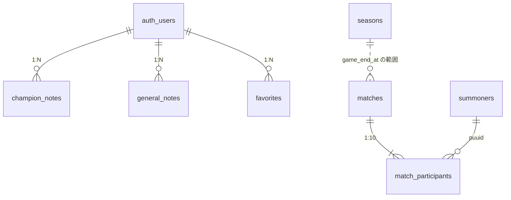

# 設計書: データベース

## 概要

- DB: Supabase（PostgreSQL）。将来 AWS へ移行する可能性があるため、PostgreSQL 標準の機能だけを使う
- ユーザーは Supabase の `auth.users` を使う（独自のユーザーテーブルは持たない）
- SQL の正は `supabase/migrations/`。本書はテーブルの意味・制約・アクセス方針とマイグレーションの運用ルールを定義する

## マイグレーション

### ルール

- **配置**: `supabase/migrations/`
- **ファイル名**: `YYYYMMDDHHmmss_説明.sql`（Supabase CLI の標準形式）。日時は作成時の UTC。説明は英小文字のスネークケース
- **冪等性**: 何度実行しても同じ結果になるように書く
  - `CREATE TABLE IF NOT EXISTS`、`CREATE INDEX IF NOT EXISTS`
  - ポリシー・トリガーは `DROP ... IF EXISTS` の後に `CREATE`
  - 関数は `CREATE OR REPLACE`
  - 初期データは `INSERT ... ON CONFLICT ... DO UPDATE`
  - カラム追加は `ADD COLUMN IF NOT EXISTS`
- **変更・取り消し**: 適用済みのファイルは書き換えず、新しいマイグレーションで変更する
- **書式**: 冒頭に目的のコメント、`-- ===` のセクション見出し、全テーブル・カラムに `COMMENT ON` を付ける
- **適用**: Supabase SQL Editor にファイルの内容を貼り付けて、ファイル名の昇順に手動で実行する

### ファイル一覧

| ファイル | 内容 |
|---|---|
| `20240101000000_create_champion_notes.sql` | champion_notes。稼働中 DB から後追いで復元 |
| `20240102000000_create_favorites.sql` | favorites。稼働中 DB から後追いで復元 |
| `20240103000000_create_general_notes.sql` | general_notes と updated_at 自動更新トリガー |
| `20240104000000_drop_champion_notes_allok_policy.sql` | champion_notes に残っていた全許可ポリシー `allok` の削除（ユーザー分離を無効化していたため） |
| `20261105105911_create_summoner_store.sql` | summoners / matches / match_participants / seasons |
| `20261105105912_insert_seasons.sql` | seasons の初期データ |
| `20261106000000_add_failed_matches.sql` | failed_matches の作成、summoners に flex_wins / flex_losses を追加 |

`20240101`〜`20240104` は命名ルール制定前のファイルで、日時は実際の作成日ではない。

### 記録していない情報

稼働中 DB から復元したファイルには、次の情報が含まれていない。

- `general_notes` 以外のトリガー定義
- ポリシーの適用ロール（`pg_policies.roles`）
- Supabase Auth / Storage の設定

## ER 図

`summoners` と `match_participants` は `puuid` で結合するが外部キーは張らない（参加者のうち未登録のサモナーが多いため）。`seasons` と `matches` は日時範囲で対応付ける。

## アクセス方針

| 区分 | テーブル | RLS | アクセス元 |
|---|---|---|---|
| ユーザーデータ | champion_notes, general_notes, favorites | 有効。`auth.uid() = user_id` の行だけ操作可 | フロントエンド（anon キー + ログイン） |
| Riot API データ | summoners, matches, match_participants, failed_matches, seasons | 有効、ポリシーなし（anon は全拒否） | バックエンド（service キー） |

---

## ユーザーデータ

### champion_notes（対策ノート）

| カラム | 型 | 制約 | 説明 |
|---|---|---|---|
| id | bigserial | PK | |
| user_id | uuid | FK → auth.users ON DELETE CASCADE、NULL 可 | NULL 可は既存データ維持のため（本来は NOT NULL） |
| my_champion_id | text | NOT NULL | 例: `Ahri` |
| enemy_champion_id | text | NOT NULL | |
| preset_name | text | NOT NULL | 例: 「序盤安定型」 |
| runes | jsonb | | 下記 JSON 構造 |
| spells | jsonb | | サモナースペルID 2要素の配列。例: `["SummonerFlash","SummonerIgnite"]` |
| items | jsonb | | アイテムIDの配列。例: `["1055","2003"]` |
| memo | text | | 最大10,000文字（アプリ層で検証） |
| created_at, updated_at | timestamptz | 既定 now() | updated_at はアプリ層で更新 |

- インデックス: `user_id`、`my_champion_id`、`enemy_champion_id`
- RLS: SELECT / INSERT / UPDATE / DELETE とも本人のみ

**runes の構造**

| キー | 型 | 説明 |
|---|---|---|
| primaryPath | number | メインパスID（例: 8100） |
| secondaryPath | number | サブパスID |
| keystone | number | キーストーンID |
| primaryRunes | number[3] | メインルーン |
| secondaryRunes | number[2] | サブルーン |
| shards | number[3] | Offense / Flex / Defense |

### general_notes（汎用ノート）

| カラム | 型 | 制約 | 説明 |
|---|---|---|---|
| id | bigserial | PK | |
| user_id | uuid | NOT NULL、FK → auth.users ON DELETE CASCADE | |
| title | text | NOT NULL | 最大100文字（アプリ層で検証） |
| body | text | | マークダウン、最大10,000文字（アプリ層で検証） |
| tags | text[] | NOT NULL、既定 `{}`、CHECK 最大10個 | 各20文字以内（アプリ層で検証） |
| created_at, updated_at | timestamptz | NOT NULL、既定 now() | updated_at はトリガーで自動更新 |

- インデックス: `(user_id, updated_at DESC)`、`tags`（GIN）
- RLS: SELECT / INSERT / UPDATE / DELETE とも本人のみ

### favorites（お気に入りサモナー）

| カラム | 型 | 制約 | 説明 |
|---|---|---|---|
| id | uuid | PK、既定 gen_random_uuid() | |
| user_id | uuid | NOT NULL、FK → auth.users ON DELETE CASCADE | |
| summoner_name | text | NOT NULL | Riot ID のゲーム名 |
| tag_line | text | NOT NULL | |
| region | text | NOT NULL | |
| created_at | timestamptz | 既定 now() | |

- UNIQUE: `(user_id, summoner_name, tag_line, region)`
- インデックス: `user_id`
- RLS: SELECT / INSERT / DELETE は本人のみ。UPDATE は行わないためポリシーなし
- 1ユーザー10件までの上限はアプリ層で検証

---

## Riot API データ

### summoners（登録済みサモナー）

| カラム | 型 | 制約 | 説明 |
|---|---|---|---|
| puuid | text | PK（region と複合） | |
| region | text | PK | JP / KR / NA / EUW / EUNE / OCE |
| game_name, tag_line | text | NOT NULL | 表示用 |
| riot_id_lower | text | NOT NULL | `gamename#tagline` の小文字。検索用 |
| level | int | NOT NULL | |
| profile_icon_id | int | NOT NULL | |
| solo_tier | text | NOT NULL | UNRANKED を含む |
| solo_rank | text | NOT NULL | UNRANKED 時は空文字 |
| solo_lp, solo_wins, solo_losses | int | NOT NULL | |
| flex_wins, flex_losses | int | NOT NULL、既定 0 | フレックスの勝敗数。更新時の変更検知（ソロ+フレックスの合計比較）に使う |
| rank_position, rank_total | int | | 同ティア内順位。不明時 NULL |
| rank_top_percent | numeric | | |
| last_updated_at | timestamptz | NOT NULL | 最後に更新（同期部分）が完了した日時 |
| synced_until | timestamptz | | Backfill カーソル（新しい側）。この日時以降は欠けなく保存済み |
| backfill_cursor | timestamptz | | Backfill カーソル（古い側）。この日時より新しい試合は欠けなく保存済み |
| backfill_completed | boolean | NOT NULL、既定 false | 古い側を履歴の最後まで取得済み |
| backfill_started_at | timestamptz | | Backfill の二重実行防止 |
| created_at | timestamptz | NOT NULL、既定 now() | |

- インデックス: `(region, riot_id_lower)`。RiotId は他人に再利用されることがあるため UNIQUE にしない（同一 RiotId が複数ある場合は `last_updated_at` が新しい行を使う）

### matches（試合）

| カラム | 型 | 制約 | 説明 |
|---|---|---|---|
| match_id | text | PK | 例: `JP1_123456` |
| queue_id | int | NOT NULL | 420 = ソロ/デュオ、440 = フレックス |
| game_mode | text | NOT NULL | |
| game_version | text | NOT NULL | 例: `15.10.678.1234`。パッチ別分析用 |
| game_duration | int | NOT NULL | 秒 |
| game_end_at | timestamptz | NOT NULL | |
| created_at | timestamptz | NOT NULL、既定 now() | |

### match_participants（試合参加者の成績）

1試合につき10行。

| カラム | 型 | 制約 | 説明 |
|---|---|---|---|
| match_id | text | PK、FK → matches ON DELETE CASCADE | |
| puuid | text | PK | |
| riot_id_game_name, riot_id_tagline | text | | 試合時点の RiotId（試合詳細の表示用） |
| team_id | int | NOT NULL | 100 / 200 |
| team_position | text | NOT NULL | TOP / JUNGLE / MIDDLE / BOTTOM / UTILITY（不明時は空文字） |
| champion_id | int | NOT NULL | |
| champion_name | text | NOT NULL | |
| win | boolean | NOT NULL | |
| kills, deaths, assists | int | NOT NULL | |
| cs | int | NOT NULL | ミニオン + 中立モンスター |
| gold_earned | int | NOT NULL | |
| damage_to_champions | int | NOT NULL | |
| vision_score | int | NOT NULL | |
| item_ids | int[] | NOT NULL | item0〜6 |
| spell1_id, spell2_id | int | NOT NULL | サモナースペル |
| keystone_id | int | NOT NULL | |
| primary_style_id, sub_style_id | int | NOT NULL | ルーンツリー |
| queue_id | int | NOT NULL | matches から非正規化 |
| game_end_at | timestamptz | NOT NULL | matches から非正規化 |

- インデックス: `(puuid, game_end_at DESC)`（サモナーの試合一覧・期間集計）、`(champion_id, team_position)`（チャンピオン・ロール別の分析）
- `queue_id` と `game_end_at` は、サモナー単位の一覧・集計を JOIN なしで行うために持つ
- マッチアップ（同じ試合・同じ `team_position`・異なる `team_id`）は自己結合で求める

### failed_matches（取得に失敗した試合）

Backfill で試合詳細の取得に失敗した試合を記録し、再取得と取得不能の判定に使う。

| カラム | 型 | 制約 | 説明 |
|---|---|---|---|
| match_id | text | PK | |
| attempts | int | NOT NULL、既定 1 | 失敗回数 |
| last_error | text | | 最後のエラー内容（ステータスコード等。機密情報は含めない） |
| last_attempt_at | timestamptz | NOT NULL、既定 now() | |
| gave_up | boolean | NOT NULL、既定 false | 3回失敗で true（取得不能） |

- 取得に成功したら行を削除する

### seasons（シーズン定義）

| カラム | 型 | 制約 | 説明 |
|---|---|---|---|
| id | text | PK | 例: `2025-S1` |
| name | text | NOT NULL | 表示名 |
| start_at | timestamptz | NOT NULL | |
| end_at | timestamptz | | 現行シーズンは NULL |

- Riot API にシーズン期間を返す API がないため、マイグレーションで手動登録する
- 試合のシーズンは `game_end_at` が `start_at` 以上かつ `end_at` 未満で判定する。シーズン ID を試合側に持たせないことで、期間の修正が既存データに影響しない
- 全期間の統計はシーズンで絞り込まずに集計する

---

## 容量の目安

- `match_participants` は1行あたり約300バイト（インデックス込み）。1試合で約3KB
- Supabase 無料プラン（500MB）では約15万試合が上限の目安。超える場合は有料プランまたは AWS への移行で対応する
