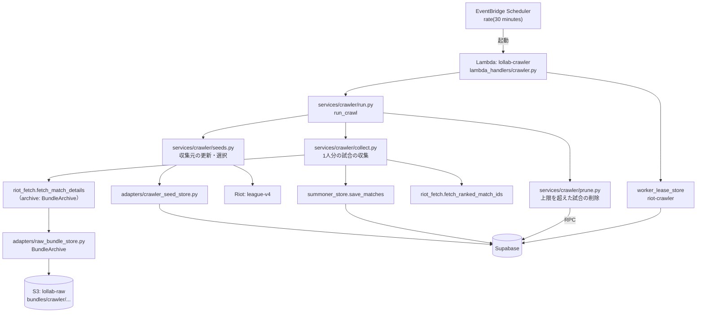

# 設計書: 試合の自動収集（クローラー）

## 概要

EventBridge Scheduler が30分ごとに Lambda `lollab-crawler` を起動する。クローラーは JP のエメラルド以上のプレイヤー（収集元プレイヤー）を順に選び、直近のソロランクの試合のうち未保存のものを、検索・Backfill と同じ取得処理（試合詳細 + タイムライン）で保存する。
試合と参加者にはランク帯を記録し、生データは1回の起動分を1つのファイルにまとめて S3 に置く。最後に、上限（10万試合）を超えたクローラーの試合を古い順に削除する。

使うテーブル: `crawler_seeds`（新規）、`matches`・`match_participants`（`rank_tier` 列を追加）、`match_bans`、`failed_matches`、`summoners`、`worker_leases`。定義は [database Spec](../database/design.md) を参照。
試合データの変換・保存は [summoner-search-api の design.md](../summoner-search-api/design.md)「試合データの取り込み」をそのまま使う。

## システム構成



## 処理の流れ（1回の起動）

1. リース `riot-crawler` を取得する。取得できなければ終了する（前回の起動が実行中。要件1.8）
2. 収集元プレイヤーを更新する（最後の更新から24時間以上たっていれば）
3. 収集元プレイヤーを選ぶ（ランク帯ごとに均等に、最後に収集した日時が古い順）
4. 1人ずつ、次を繰り返す。締め切り（残り150秒）・レート制限（429）・失敗の連続で止める
   1. 試合ID一覧を取得する（ソロランク `queue=420`、最大20件、前回の収集日時以降。初回は直近3日）
   2. 保存済みの試合と、取得不能（`failed_matches.gave_up`）の試合を除く
   3. 試合詳細とタイムラインを取得し、ランク帯を付けて保存する。生データはバンドルに追記する
   4. 収集元プレイヤーの最後の収集日時を更新する
5. バンドルを S3 に書き込む（試合が1件以上あれば）
6. 上限を超えたクローラーの試合を削除する
7. 結果をログに出し、リースを返す

- 取得失敗（429 以外）は既存の `failed_matches` に記録する（3回で取得不能。Backfill と同じ）
- 429 で止めた場合、取得済みの試合は保存してから終える。次の起動では同じ収集元から続ける（最後の収集日時を更新しないため）

### 収集元プレイヤー

| ランク帯 | 取得方法 | Riot API の呼び出し |
|---|---|---|
| チャレンジャー・グランドマスター・マスター | `/lol/league/v4/{challenger,grandmaster,master}leagues/by-queue/RANKED_SOLO_5x5` | 3回 |
| ダイヤモンド・エメラルド | `/lol/league/v4/entries/RANKED_SOLO_5x5/{tier}/{I〜IV}?page=1`（1ページ約200人） | 8回 |

- 更新は1日1回。取得したプレイヤーを `crawler_seeds` に upsert し、7日以上更新されていない行（降格・非アクティブ）を削除する
- 選択は「エメラルド」「ダイヤモンド」「マスター以上」の3つの帯から交互に1人ずつ、`last_crawled_at` が古い順（NULL が先）
- 試合のランク帯は、収集元プレイヤーの tier（`EMERALD` / `DIAMOND` / `MASTER` / `GRANDMASTER` / `CHALLENGER`）

### Riot API の利用量の分け合い

各関数のプロセス内で数える既存の仕組みで、関数ごとに上限を割り当てる。合計はキーの上限（20:1、100:120）以内。

| 関数 | `RIOT_RATE_LIMITS` | `RIOT_RATE_LIMIT_MAX_WAIT_SECONDS` | 変更 |
|---|---|---|---|
| `lollab-api` | `6:1,30:120` | 10（既定） | `8:1,50:120` から下げる |
| `lollab-backfill` | `4:1,20:120` | 10（既定） | `10:1,45:120` から下げる |
| `lollab-crawler` | `8:1,45:120` | 130 | 新規。2分の窓が埋まっても止めずに空くまで待つ |

- 想定の収集量: 1回の起動で約170回（約7分 × 45回/2分）→ 収集元8人前後の ID 一覧 + 約80試合 × 2回。1日48回で約3,800試合（要件1.7）
- 上限は `app.yaml` のパラメータ（`ApiRateLimits`・`BackfillRateLimits`・`CrawlerRateLimits`）で変える（要件3.2）
- `lollab-api` の上限は初回登録（最大約45回）に足りなくなる。初回登録はレート制限で一部の試合が後回しになり、Backfill で補われる（既存の仕組み）

### 生データのまとめ保存

- `match_bundle.fetch_match` の生データの保管を、差し替えられる `RawArchive` にする。既定は今の1試合1ファイル（`matches/{match_id}/detail.json.gz`・`timeline.json.gz`）で、検索・Backfill の挙動は変えない
- クローラーは `BundleArchive` を渡す。受け取った JSON を1行ずつ（`{"match_id", "kind": "detail"|"timeline", "data"}`）gzip のストリームに追記し、起動の最後に1回だけ S3 に書き込む（メモリに未圧縮の JSON を溜めない）
- キー: `bundles/crawler/{YYYY-MM-DD}/{起動 ID}.jsonl.gz`（UTC の日付）。書き込みに失敗してもログに残すだけで、DB の保存は取り消さない
- 既存の1試合1ファイルの生データはそのまま読める（要件4.5）。タイムラインを取り直すときに生データの試合詳細が見つからなければ、既存の処理どおり Riot API から取り直す

### 保存量の上限

- `prune_crawler_matches(max_matches int, batch int)`（PostgreSQL の関数、RPC で呼ぶ）が、`rank_tier` を持つ試合のうち、`summoners` に登録済みのプレイヤーが参加していない試合を数え、上限を超えた分を `game_end_at` の古い順に最大 `batch` 件削除する。参加者・BAN は外部キーで一緒に消える
- 1回の起動で最大2,000件。超過が大きくても数回の起動で上限に戻る
- `rank_tier` を持つ試合がクローラーの試合。クローラーは保存済みの試合を取り直さないため、検索由来の試合に `rank_tier` が付くことはない（要件2.3、4.3）

## インフラ（app.yaml）

| リソース | 内容 |
|---|---|
| `CrawlerFunction` | `lollab-crawler`。同じ ZIP、ハンドラー `lambda_handlers.crawler.handler`。Python 3.12、arm64、256MB、タイムアウト600秒 |
| `CrawlerSchedule` | EventBridge Scheduler の `rate(30 minutes)`。`State` はパラメータ `CrawlerEnabled`（`ENABLED` / `DISABLED`）。再試行なし |
| `CrawlerScheduleRole` | Scheduler が `lollab-crawler` を起動するためのロール |
| `CrawlerRole` | ロググループへの書き込み、`riot_api_key`・`supabase_key`・`supabase_url` の `ssm:GetParameters`、`lollab-raw` の `bundles/*` への Put |
| `CrawlerLogGroup` | 14日 |

- 環境変数: `SSM_PARAMETER_PATH`、`SSM_PARAMETER_NAMES`、`RIOT_RATE_LIMITS`、`RIOT_RATE_LIMIT_MAX_WAIT_SECONDS=130`、`RIOT_BACKFILL_RESERVE_RATIO=0`、`RAW_BUCKET`
- 停止・再開は `CrawlerEnabled`（bootstrap の `AppCrawlerEnabled` → buildspec の上書き）で行う（要件6.2）。停止中は起動されないため料金もかからない
- 費用: 256MB × 最大600秒 × 1日48回 = 月約21.6万 GB 秒。`lollab-api`・`lollab-backfill` と合わせても無料枠（40万 GB 秒）に収まる。Scheduler は月1,440回で無料枠内。128MB は supabase・httpx・boto3 の読み込みで足りなくなるおそれがあるため使わない
- `bootstrap.yaml` の CloudFormation のサービスロールに、`scheduler:*Schedule` と、`iam:PassRole`（`scheduler.amazonaws.com` 向け）を足す

## コンポーネントとインターフェース

```
backend/
├── lambda_handlers/crawler.py          # リース・締め切り・終了処理
├── services/crawler/
│   ├── run.py                          # 1回の起動の流れ
│   ├── seeds.py                        # 収集元の更新・選択
│   ├── collect.py                      # 1人分の試合の収集
│   └── prune.py                        # 上限を超えた試合の削除
├── adapters/
│   ├── crawler_seed_store.py
│   ├── raw_bundle_store.py             # BundleArchive
│   └── raw_store.py                    # RawArchive（既定の1試合1ファイル）を追加
└── schemas/crawler.py
```

```python
# schemas/crawler.py
RankTier = Literal["EMERALD", "DIAMOND", "MASTER", "GRANDMASTER", "CHALLENGER"]
StopReason = Literal["completed", "deadline", "rate_limited", "too_many_failures", "no_seeds"]

class CrawlerSeed(BaseModel):
    puuid: str
    tier: RankTier
    division: str | None            # マスター以上は None
    league_points: int
    refreshed_at: datetime
    last_crawled_at: datetime | None

class CrawlResult(BaseModel):
    stop_reason: StopReason
    seeds_crawled: int
    matches_saved: int
    matches_failed: int
    matches_pruned: int
    riot_requests: int

# services/crawler/run.py
async def run_crawl(region: str, deadline: Deadline, run_id: str) -> CrawlResult

# services/crawler/seeds.py
async def refresh_seeds_if_stale(region: str) -> None
async def pick_seeds(limit: int) -> list[CrawlerSeed]

# services/crawler/collect.py
async def collect_seed(region: str, seed: CrawlerSeed, archive: RawArchive) -> CollectResult  # 429 は RiotRateLimitError

# services/crawler/prune.py
async def prune(max_matches: int = 100_000, batch: int = 2_000) -> int  # 削除した試合数

# adapters/crawler_seed_store.py
async def get_last_refreshed_at() -> datetime | None
async def upsert_seeds(seeds: list[CrawlerSeed]) -> None
async def delete_stale_seeds(older_than: datetime) -> int
async def get_seeds_by_band(band: list[RankTier], limit: int) -> list[CrawlerSeed]
async def mark_crawled(puuid: str, at: datetime) -> None

# adapters/raw_store.py
class RawArchive(Protocol):
    async def save_detail(self, match_id: str, payload: dict[str, Any]) -> None: ...
    async def save_timeline(self, match_id: str, payload: dict[str, Any]) -> None: ...

# adapters/raw_bundle_store.py
class BundleArchive:            # RawArchive を満たす
    def __init__(self, key: str) -> None
    async def flush(self) -> int    # S3 に書き込み、試合数を返す。0件なら書き込まない
```

既存への変更:

- `riot_fetch.fetch_ranked_match_ids` に `queue: int | None = None` を足す（指定時は `queue` パラメータを付ける）
- `riot_fetch.fetch_match_details`・`match_bundle.fetch_match` に `archive: RawArchive | None = None` を足す（None は既定の1試合1ファイル）
- `ParticipantRecord`・`MatchRecord` に `rank_tier: str | None = None` を足す。None のときは保存時にその列を書き込まない（タイムライン由来の列と同じ扱い。要件2.2）

## ログ（要件6.1）

起動ごとに1行、`CrawlResult` を JSON で出す（`logger.info`）。秘密情報・PUUID は出さない。個別の失敗は既存どおり試合 ID とステータスコードだけを出す。

## エラー処理

| 状況 | 動作 |
|---|---|
| リースを取得できない | 何もせず終了（`lease_unavailable`） |
| 収集元の更新に失敗 | ログに残し、既存の収集元で続ける。収集元が0人なら `no_seeds` で終了 |
| 429・送信前のレート制限 | 取得済みを保存して `rate_limited` で終了 |
| 試合の取得失敗（5xx・タイムアウト） | `failed_matches` に記録して次の試合へ（要件3.4） |
| 試合 ID 一覧の取得失敗 | その収集元を飛ばす（最後の収集日時は更新しない） |
| 1回の起動で失敗が10件 | `too_many_failures` で終了（要件3.5） |
| 締め切り（残り150秒） | 次の収集元に進まず `deadline` で終了。2分の窓の待ち（最大120秒）と保存の余裕 |
| バンドルの書き込み失敗 | ログに残す（DB は保存済み） |
| 削除（prune）の失敗 | ログに残す（次の起動で再実行） |

## champion-stats への影響

ランク帯の絞り込み（champion-stats 要件4.3〜4.4）は [champion-stats の design.md](../champion-stats/design.md) で扱う。`match_participants.rank_tier` で絞り込む。

## テスト方針

| 対象 | 内容 |
|---|---|
| `seeds.py` | 更新の要否（24時間）、帯ごとの交互の選択、古い順、7日で削除 |
| `collect.py` | `queue=420` と期間の指定、保存済み・取得不能の除外、ランク帯の付与、429 で取得済みを保存して送出、収集日時は成功時だけ更新 |
| `run.py` | 締め切り・429・失敗10件での終了理由、バンドルの書き込み、prune の呼び出し、`CrawlResult` の値 |
| `BundleArchive` | 追記した行を読み戻せる、0件なら書き込まない（S3 は moto） |
| `RawArchive` の既定 | 検索・Backfill の保存先が変わらない（既存テストが通る） |
| `save_matches` | `rank_tier` が None なら既存の値を消さない |
| `prune_crawler_matches` | 上限以下なら0件、検索済みサモナーの試合・`rank_tier` なしの試合は消さない、古い順（SQL は手動で確認） |
| ハンドラー | リースを取れないとき何もしない、リースを必ず返す |
| 手動 | デプロイ後の1回目の起動のログ、DB の件数、S3 のバンドル、Riot の 429 が出ないこと |
