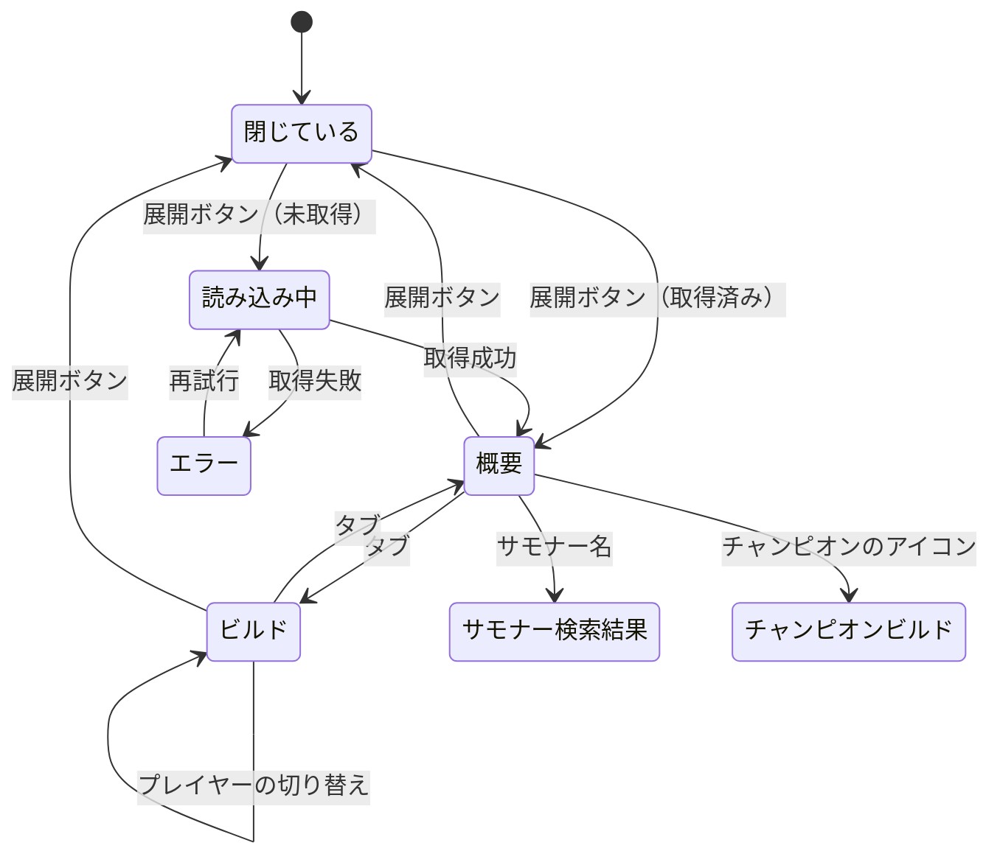

# 設計書: 試合詳細

## 概要

試合カードの展開ボタンで `GET /api/match/{matchId}` を呼び、保存済みの生データ（試合詳細・タイムライン）から10人の成績・チームの結果・ビルドを作って返す。フロントエンドはカードの下に「概要」「ビルド」のタブで表示する。

使うテーブル: `matches`（`raw_bundle_key` を追加）、`summoners`、`crawler_seeds`。定義は [database Spec](../database/design.md) を参照。
生データの保存は [summoner-search-api の design.md](../summoner-search-api/design.md)「試合データの取り込み」と [match-crawler の design.md](../match-crawler/design.md)「生データのまとめ保存」を参照。

## システム構成

```mermaid
graph TB
    Card["MatchCard<br/>展開ボタン"] --> Panel["MatchDetailPanel<br/>概要 / ビルド"]
    Panel --> Hook["useMatchDetail<br/>（SearchResultPage 内でキャッシュ）"]
    Hook -->|GET /api/match/{matchId}| Router["api/match/router.py<br/>require_allowed_user"]
    Router --> Svc["services/match/detail.py"]
    Svc --> Raw["services/match/raw_source.py<br/>生データの読み出し"]
    Raw --> RawStore["adapters/raw_store.py<br/>1試合1ファイル"]
    Raw --> Bundle["adapters/raw_bundle_store.py<br/>まとめファイルから1試合を探す"]
    Raw -->|生データがない| Riot["Riot API（interactive）"]
    Svc --> Conv["services/match/convert.py<br/>成績・チーム・ビルドの組み立て（純粋関数）"]
    Svc --> Rank["adapters/match_rank_store.py<br/>summoners・crawler_seeds"]
    RawStore --> S3[("S3: lollab-raw")]
    Bundle --> S3
    Rank --> DB[("Supabase")]
```

## 画面遷移



## バックエンド

### 生データの読み出し（raw_source.py）

1. `matches` に行がなければ 404（DB にない試合 ID で Riot API を呼ばせない。要件5.2）
2. 1試合1ファイル（`matches/{id}/detail.json.gz`・`timeline.json.gz`）を読む
3. 試合詳細がなく `raw_bundle_key` があれば、まとめファイルを読みながら展開し、その試合の `detail`・`timeline` の行だけを取り出す。見つかったら1試合1ファイルとして保存する（次回から2で読める）
4. それでも試合詳細がなければ、Riot API（`priority="interactive"`）から試合詳細とタイムラインを取得し、1試合1ファイルとして保存する（要件4.2）
5. タイムラインだけがない場合は、Riot API からタイムラインだけを取り直す。取得できなければ `None` のまま返す（要件4.3）

- Riot API の 429 は 429、その他の失敗は 502（試合詳細が取れない場合）。生データの保存の失敗はログに残して表示は続ける
- まとめファイルは1起動分（約70試合・約5MB）。全体を読み込まず、行ごとに展開して探す

### 組み立て（convert.py、純粋関数）

| 項目 | 生データの元 |
|---|---|
| 成績 | `info.participants[]`: `champLevel`、`kills`/`deaths`/`assists`、`totalDamageDealtToChampions`、`totalDamageTaken`、`wardsPlaced`、`wardsKilled`、`totalMinionsKilled + neutralMinionsKilled`、`goldEarned`、`item0〜6`、`summoner1Id`/`summoner2Id`、`perks` |
| キル関与率 | (キル + アシスト) / チームの合計キル（0除算は0）。0〜1 の比率で返す |
| チーム | `info.teams[]`: `win`、`objectives` の `baron`・`dragon`・`riftHerald`・`horde`（ヴォイドグラブ）・`atakhan`・`tower`・`inhibitor` の `kills`。合計キル・合計ゴールドは参加者の合計 |
| アイテムの購入順 | タイムラインの `ITEM_PURCHASED`。`ITEM_UNDO` で取り消された購入は除く（直前の同じアイテムの購入を1件消す）。分（`timestamp // 60000`）ごとにまとめる |
| スキルの上げ順 | タイムラインの `SKILL_LEVEL_UP`（`levelUpType = NORMAL`）。`skillSlot` 1〜4 |
| スキルの最大化順 | 既存の `services/champion/skill_priority.py` を使う |

- タイムラインの参加者は `participantId` で試合詳細の参加者と対応させる（既存の `participant_puuids` を使う）

### ランク（match_rank_store.py）

- 10人の PUUID で `summoners`（`solo_tier`・`solo_rank`）を引き、なければ `crawler_seeds`（`tier`・`division`）を引く。どちらにもなければ `None`（要件2.8・4.4）
- 試合時点ではなく、今わかっているランクを出す

### API

| メソッド | パス | 応答 |
|---|---|---|
| GET | `/api/match/{matchId}` | `MatchDetailResponse` |

- `matchId`: `^[A-Z0-9]{2,5}_[0-9]{1,20}$`。不正は 422、DB にない試合は 404
- `require_allowed_user` を付ける（要件5.1）。`main.py` にルーターを登録する
- 応答は同じ試合なら変わらないため、`Cache-Control: private, max-age=86400` を付ける

### スキーマ（schemas/match_detail.py）

```python
class RankBrief(BaseModel):
    tier: str                       # EMERALD など
    division: str | None            # マスター以上は None

class ItemPurchaseGroup(BaseModel):
    minute: int
    item_ids: list[int]             # 購入順

class ParticipantBuild(BaseModel):
    item_purchases: list[ItemPurchaseGroup]
    skill_order: list[int]          # 1=Q, 2=W, 3=E, 4=R
    skill_priority: list[int]       # 最大化の順（例: [1, 2, 3]）

class ParticipantDetail(BaseModel):
    puuid: str
    riot_id_game_name: str | None
    riot_id_tagline: str | None
    team_id: int
    team_position: str
    champion_name: str
    champ_level: int
    spell_ids: list[int]            # [spell1, spell2]
    primary_style_id: int
    sub_style_id: int
    primary_perk_ids: list[int]     # キーストーン含む4つ
    sub_perk_ids: list[int]
    stat_perk_ids: list[int]        # offense, flex, defense
    kills: int
    deaths: int
    assists: int
    kill_participation: float       # 0〜1
    damage_to_champions: int
    damage_taken: int
    wards_placed: int
    wards_killed: int
    cs: int
    gold_earned: int
    item_ids: list[int]             # item0〜6（0 は空き）
    rank: RankBrief | None
    build: ParticipantBuild | None  # タイムラインがない場合は None

class TeamDetail(BaseModel):
    team_id: int                    # 100 = ブルー、200 = レッド
    win: bool
    kills: int
    gold: int
    objectives: dict[str, int]      # baron, dragon, rift_herald, horde, atakhan, tower, inhibitor

class MatchDetailResponse(BaseModel):
    match_id: str
    queue_id: int
    game_duration: int              # 秒
    game_end_at: datetime
    teams: list[TeamDetail]
    participants: list[ParticipantDetail]   # チームごと・team_position の順（TOP, JUNGLE, MIDDLE, BOTTOM, UTILITY）
```

### 構成

```
backend/
├── api/match/router.py
├── services/match/
│   ├── detail.py        # 取得と組み立ての流れ
│   ├── raw_source.py    # 生データの読み出し（1試合1ファイル → まとめ → Riot API）
│   ├── convert.py       # 成績・チーム（純粋関数）
│   └── build_timeline.py # 購入順・スキル順（純粋関数）
├── adapters/
│   ├── match_rank_store.py
│   ├── raw_bundle_store.py   # find_in_bundle(key, match_id) を追加
│   └── summoner_store.py     # get_raw_bundle_key(match_id) を追加（試合の有無も兼ねる）
└── schemas/match_detail.py
```

```python
# services/match/detail.py
async def get_match_detail(match_id: str) -> MatchDetailResponse   # 404, 429, 502 は HTTPException

# services/match/raw_source.py
async def load_raw(match_id: str, bundle_key: str | None) -> tuple[dict[str, Any], dict[str, Any] | None]

# adapters/raw_bundle_store.py
async def find_in_bundle(key: str, match_id: str) -> tuple[dict[str, Any] | None, dict[str, Any] | None]

# adapters/match_rank_store.py
async def get_ranks(puuids: list[str]) -> dict[str, RankBrief]
```

### クローラーへの変更

- クローラーが試合を保存するとき、`matches.raw_bundle_key` にその起動のまとめファイルのキーを書く（`MatchRecord.raw_bundle_key`。None のときは書き込まない）
- まとめファイルの書き込みに失敗した場合、キーは存在しないファイルを指す。読み出し時は見つからない扱いになり、Riot API から取り直す
- 変更前に集めた試合（`raw_bundle_key` なし）も、Riot API から取り直して表示できる

## フロントエンド

### 構成

```
frontend/src/
├── adapters/api/matchDetail.ts            # fetchMatchDetail(matchId)
├── types/matchDetail.ts
├── lib/match-detail/                      # KDA の比率・分あたり CS・ダメージの割合・チームの並び（純粋関数）
└── components/match-detail/
    ├── MatchDetailPanel.tsx               # 読み込み中・エラー（再試行）・タブの切り替え
    ├── useMatchDetail.tsx                 # 取得と、SearchResultPage 内のキャッシュ（Context）
    ├── overview/
    │   ├── OverviewTab.tsx
    │   ├── TeamTable.tsx                  # 勝敗・チームの色・5人の行
    │   ├── ParticipantRow.tsx             # 対象プレイヤーの行を強調
    │   ├── DamageBar.tsx
    │   └── TeamComparison.tsx             # 合計キル・合計ゴールドの比較とオブジェクト
    └── build/
        ├── BuildTab.tsx
        ├── PlayerSelector.tsx             # 10人のチャンピオンのアイコンで切り替え
        ├── ItemTimeline.tsx               # 分ごとのまとまりを「>」でつなぐ
        ├── SkillOrderView.tsx             # 最大化の順と、レベルごとの Q/W/E/R
        └── RuneTreeView.tsx               # runes.ts の全ルーンを並べ、選んだものを強調
```

- `MatchCard` に展開ボタン（`<button>`、`aria-expanded`）を付け、開いているときだけ `MatchDetailPanel` を描画する。向きは開閉で反転する（要件1.3）
- キャッシュは `SearchResultPage` の中に置く Context（`matchId → MatchDetailResponse`）。別のサモナーを検索すると消える（要件1.6）
- 対象プレイヤーの判定に検索したサモナーの PUUID を使う。`SummonerData` に `puuid` を追加する（バックエンドの応答にも追加）
- 表の列: チャンピオン（アイコン・レベル）、スペル・ルーン（メインのキーストーンとサブのツリー）、名前とランク、KDA とキル関与率（例: `0/10/2 (20%)`）と KDA の比率、与ダメージ・受けたダメージ（数値と棒）、ワード（設置 / 破壊）、CS（分あたり）、アイテム
- 色は design-system.md の役割の名前を使う。勝利チームは `bg-win/15`、敗北チームは `bg-loss/15`、対象プレイヤーの行は `ring-2 ring-accent bg-accent/15`
- 画像: チャンピオン `/images/champion/`、アイテム `/images/item/`、ルーン `/images/runes/`（既存の静的画像）。サモナースペルは Data Dragon の CDN（champion-stats と同じ）
- 狭い画面では表を横にスクロールできるようにする（列は減らさない）

### 画面の移動

- **サモナー名**: サモナー検索の画面を URL で開けるようにする。トップページ（`/`）がクエリ `region`・`q`（`gameName#tagLine`）を読み、あれば検索結果を表示する（`useSearchParams` を `Suspense` で囲む）。検索したときもクエリを更新する（ブラウザの戻るで前のサモナーに戻れる）。名前は `/?region=JP&q=...` へのリンクにする
- **チャンピオンのアイコン**: `buildChampionBuildHref(championName, { role: team_position, ...既定値 })` へのリンクにする。`team_position` が空ならロールを付けない

## エラー処理

| 状況 | API | 画面 |
|---|---|---|
| 試合 ID が不正 | 422 | 「試合詳細を取得できませんでした」と再試行ボタン |
| DB にない試合 | 404 | 同上 |
| Riot API の 429 | 429 | 「しばらくしてから再試行してください」と再試行ボタン |
| 試合詳細の取得失敗 | 502 | 「試合詳細を取得できませんでした」と再試行ボタン |
| タイムラインがない | 200（`build = None`） | ビルドタブのアイテムの購入順とスキル順を「データなし」、ルーンは表示 |
| 認証エラー | 401・403 | 既存の AuthGate の扱い |

## テスト方針

| 対象 | 内容 |
|---|---|
| `convert.py` | キル関与率（0除算）、チームの合計・オブジェクト、参加者の並び |
| `build_timeline.py` | 購入の取り消し（`ITEM_UNDO`）、分ごとのまとまり、スキル順（`EVOLVE` を除く） |
| `raw_source.py` | 1試合1ファイル → まとめファイル → Riot API の順、まとめから見つけたら1試合1ファイルに保存、タイムラインだけ取り直し |
| `find_in_bundle` | 目的の試合の行だけを返す、見つからなければ None（moto） |
| `match_rank_store` | summoners を優先、なければ crawler_seeds、どちらもなければ含めない |
| router | 422・404・429・502、認証の依存が付いている |
| クローラー | `raw_bundle_key` が保存される |
| フロントエンド | 展開と折りたたみ・キャッシュ、読み込み中とエラーの表示、対象プレイヤーの強調、KDA とキル関与率の表示、ビルドのプレイヤー切り替え、データなし、リンク先の URL、トップページのクエリでの検索 |
