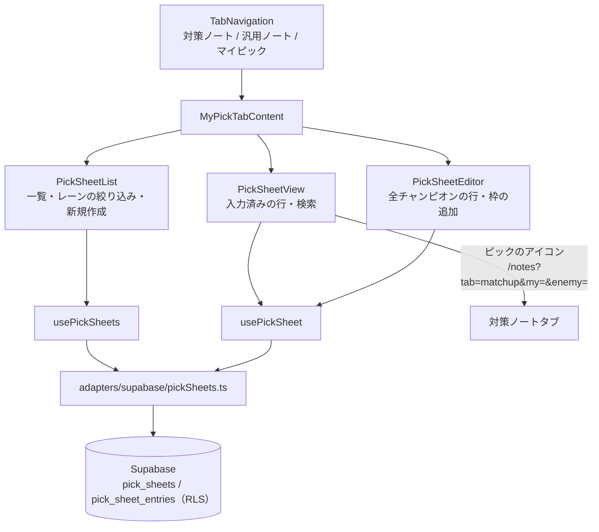
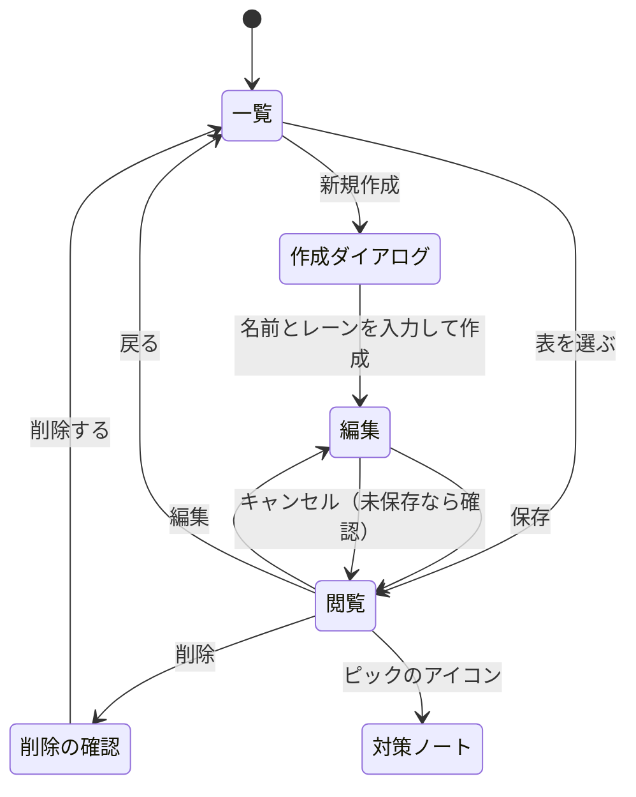

# 設計書: マイピック

## 概要

ノート画面に「マイピック」タブを足す。表（`pick_sheets`）とピック（`pick_sheet_entries`）は、既存のノートと同じくブラウザから Supabase を直接読み書きし、RLS で本人のデータだけに限る。バックエンド（FastAPI）は使わない。
自分のピックのアイコンからは、ノート画面を URL のクエリで開き、対策ノートタブで「ピック vs 相手」を選んだ状態にする。

使うテーブル: `pick_sheets`、`pick_sheet_entries`（新規）、`champion_notes`（既存）。定義は [database Spec](../database/design.md) を参照。

## システム構成



## 画面遷移



## データ

### 型（types/myPick.ts）

```typescript
type PickLane = 'TOP' | 'JUNGLE' | 'MIDDLE' | 'BOTTOM' | 'UTILITY';

interface PickSheet {
  id: number;
  name: string;            // 1〜50文字
  lane: PickLane;
  entryCount: number;      // ピックが1つ以上ある相手の数（一覧用）
  createdAt: string;
  updatedAt: string;
}

interface PickRow {
  enemyChampionId: string;     // champions.ts の id（例: Ahri）
  pickChampionIds: string[];   // 順番どおり、最大10、重複なし
}

interface PickSheetDetail extends PickSheet {
  rows: PickRow[];             // ピックが1つ以上ある行だけ
}
```

- レーンの表示名: TOP / JUNGLE / MID / BOT / SUPPORT（値は試合データの `team_position` と同じにする）
- チャンピオンの id は対策ノート（`champion_notes.my_champion_id`）と同じ `champions.ts` の id

### adapters/supabase/pickSheets.ts

```typescript
async function getPickSheets(): Promise<PickSheet[]>                       // 更新日時の新しい順
async function getPickSheet(id: number): Promise<PickSheetDetail | null>
async function createPickSheet(name: string, lane: PickLane): Promise<PickSheet>
async function savePickSheet(id: number, name: string, lane: PickLane, rows: PickRow[]): Promise<void>
async function deletePickSheet(id: number): Promise<void>
```

- `savePickSheet` は、表の名前・レーンを更新し、その表のピックを全件削除してから入れ直す（`rows` が空の行は保存しない）。ピックは1行（相手1体）につき1レコードで、`pick_champion_ids` に順番どおりの配列で持つ
- `entryCount` は `pick_sheet_entries` の件数（一覧では `pick_sheet_entries(count)` で取得）
- 保存は2回のリクエストに分かれるため原子的ではない。途中で失敗したらエラーを出し、編集内容は画面に残して再保存できるようにする

### 入力の検証（lib/my-pick/）

- 表の名前: 前後の空白を除いて1〜50文字
- ピック: 1行につき最大10、重複なし、`champions.ts` にある id だけ。相手と同じチャンピオンも選べる（ミラー）
- DB 側でも制約で守る（database Spec）

## フロントエンド

```
frontend/src/
├── types/myPick.ts
├── adapters/supabase/pickSheets.ts
├── lib/my-pick/                         # 検証、レーンの表示名、行の絞り込み（検索・入力済み）、枠の追加・削除・入れ替え（純粋関数）
├── lib/notes/buildNotesHref.ts          # /notes?tab=&my=&enemy= を作る
├── components/my-pick/
│   ├── MyPickTabContent.tsx             # 一覧・閲覧・編集の切り替え
│   ├── usePickSheets.tsx / usePickSheet.tsx
│   ├── list/  PickSheetList, PickSheetCard, LaneFilter, CreatePickSheetDialog
│   ├── view/  PickSheetView, PickViewRow（相手のアイコン・名前と、ピックのアイコンのリンク）
│   └── edit/  PickSheetEditor, PickEditRow（相手 + 枠 + 「＋」）, PickSlot, ChampionPickerPopover, SheetMetaForm
└── components/notes/TabNavigation.tsx   # 'mypick' を追加
```

- **タブ**: `TabType` に `'mypick'` を足す。`NotesPageContent` でマイピックタブのときは `MyPickTabContent` を出す（チャンピオン選択のサイドバーは出さない）
- **編集の行**: 全チャンピオン（約170）を相手として並べる。各行は相手のアイコン・名前、ピックの枠（初期3、表示中の枠数はその行のピック数と3の大きい方）、「＋」（10で無効）。枠を押すとチャンピオン選択（検索付きのポップオーバー）を開き、選んだら枠に入る。枠の「×」で外すと右の枠が詰まる
- **編集の上部**: 名前・レーン、相手の検索、「入力済みの行だけ表示」、保存・キャンセル
- **未保存の確認**: 変更があればキャンセル・タブの切り替え・ページを離れるとき（`beforeunload`）に確認する
- **閲覧**: 入力済みの行だけを、相手のアイコン・名前と、ピックのアイコン（順番どおり）で表示する。検索付き。ピックのアイコンは `buildNotesHref({ tab: 'matchup', my: pick, enemy })` へのリンク
- 行数が多いため、行のコンポーネントは `React.memo` にし、チャンピオン画像は `loading="lazy"` にする
- 色・状態は design-system.md の役割の名前。行は詰めて区切り線で分ける（試合詳細の概要と同じ詰め方）

### ノート画面を URL で開く

- ノート画面（`/notes`）がクエリ `tab`（`matchup` / `general` / `mypick`）・`my`・`enemy` を読み、初期状態にする（`useSearchParams` を `Suspense` で囲む）。`my`・`enemy` は `champions.ts` にある id だけを受け付け、なければ無視する
- `tab=matchup&my=X&enemy=Y` で開くと、対策ノートタブで X vs Y を選んだ状態になり、既存の一覧（ノートがなければ「ノートがありません」）が出る（要件4.3・4.4）
- タブの切り替え・チャンピオンの選択でもクエリを更新する（`router.replace`。履歴は増やさない）

## エラー処理

| 状況 | 表示 |
|---|---|
| 一覧・表の読み込みに失敗 | 「読み込みに失敗しました」と再試行ボタン |
| 作成・保存・削除に失敗 | トースト（既存の対策ノートと同じ）。編集内容は残す |
| 表が見つからない（削除済みなど） | 一覧に戻し、トーストで知らせる |
| 名前の検証エラー | 入力欄の下にメッセージ。保存ボタンは無効 |

## テスト方針

| 対象 | 内容 |
|---|---|
| `lib/my-pick` | 名前の検証、枠の追加（10まで）・削除（詰める）・重複の拒否、検索（日本語名・読み・英語名）、入力済みの絞り込み |
| `pickSheets.ts` | 保存で空の行を除く・順番を保つ、件数の取得（Supabase クライアントはモック） |
| `buildNotesHref` と URL の読み取り | クエリの組み立て、不正な id を無視 |
| コンポーネント | 一覧の絞り込みと空の表示、作成ダイアログ、編集の枠の追加と「＋」の無効化、未保存の確認、閲覧のリンク先 |
| 手動 | 本番の DB で作成・保存・削除、別のユーザーから見えないこと（RLS）、ピックから対策ノートに移ること |
