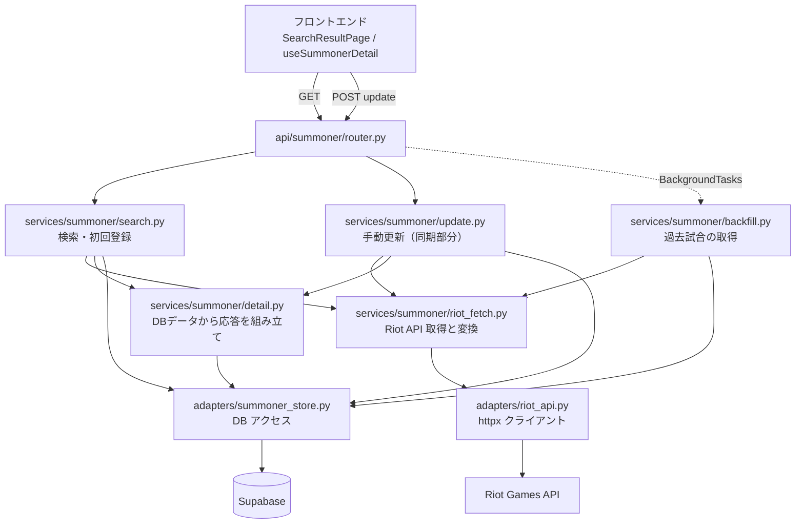
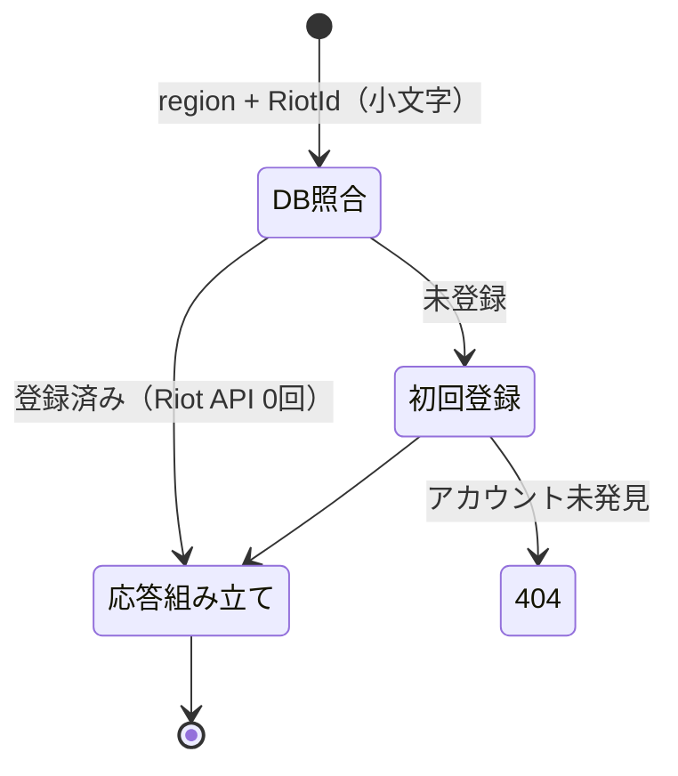

# 設計書: サモナー検索API

## 概要

Riot API から取得したサモナー情報と試合データを Supabase に保存し、検索時は DB から返す。最新化は「更新」ボタンで行い、更新時は直近20件だけを同期で取得し、残りの過去試合はバックグラウンド（Backfill）で取得する。

設計の主眼は **Riot API のリクエスト数を最小にすること**。

- 登録済みサモナーの検索は Riot API を呼ばない
- 試合は match ID 単位で1回だけ取得し、参加者10人で共有する
- 試合ID一覧の取得範囲をカーソルで記録し、取得済みの範囲は再取得しない

## システム構成



services 層は `adapters/summoner_store.py` の関数だけを使い、Supabase を直接参照しない。将来 AWS へ移行する場合は `summoner_store.py` の中身だけを差し替える。

## 処理フロー

### 検索（GET）



初回登録の Riot API 呼び出し:

| 呼び出し | 回数 |
|---|---|
| account by-riot-id | 1 |
| summoner by-puuid | 1 |
| league entries by-puuid | 1 |
| ランク順位（同ティアのリーグ一覧） | 0〜1（UNRANKED は 0） |
| match ids（`type=ranked&count=20`） | 1 |
| match 詳細 + タイムライン | DB に未保存の件数 × 2（最大40） |

取得した PUUID が別の RiotId で登録済みなら、既存レコードの RiotId を更新する。初回登録の応答後は、手動更新と同じく BackgroundTasks で Backfill を開始する。

### 手動更新（POST、同期部分）

1. DB から PUUID を取得する（未登録なら 404）
2. league entries by-puuid を取得する（1回）
3. ソロとフレックスの `wins + losses` の合計を DB の値（`solo_wins + solo_losses + flex_wins + flex_losses`）と比べる
   - **同じ**: 新しいランク戦はない。`last_updated_at` だけ更新して応答する（合計1回）
   - **異なる**: 4 に進む
4. account by-puuid（RiotId 変更の反映）、summoner by-puuid、ランク順位を取得する（2〜3回）。league entries は 2 の結果を使う
5. match ids（`type=ranked&count=20`）を取得し、DB に未保存の試合だけ詳細とタイムラインを取得する（1回 + 最大40回）
6. サモナー情報・試合を保存し、`last_updated_at` を記録する
7. 応答を返した後、BackgroundTasks で Backfill を開始する（3 で「同じ」の場合も、Backfill が未完了か、補完対象の試合が残っていれば開始する）

同期部分でエラーが起きた場合は、保存できた試合を残し、`last_updated_at` を変えずにエラーを返す。

`fetch_profile` は league entries の取得を分離し、取得済みのエントリを受け取れるようにする。

### Backfill（バックグラウンド）

`summoners` テーブルの2つのカーソルで取得済み範囲を管理し、再取得を防ぐ。

| カーソル | 意味 |
|---|---|
| `synced_until` | この日時以降の対象試合は欠けなく保存済み（新しい側の境界） |
| `backfill_cursor` | この日時より新しい対象試合は欠けなく保存済み（古い側の境界） |
| `backfill_completed` | 古い側を Riot API の履歴の最後まで取得済み |

処理順:

1. **新しい側の隙間を埋める**: `startTime = synced_until` で match ids を100件ずつ取得し、未保存の試合詳細を取得する。完了したら `synced_until` を最新の試合時刻に更新する
2. **古い側をさかのぼる**: `backfill_completed` が false なら、`endTime = backfill_cursor` で match ids を100件ずつ取得し、未保存の試合詳細を取得する。1ページ保存するごとに `backfill_cursor` をそのページ最古の試合時刻に更新する。返却が100件未満なら `backfill_completed = true`

- ページ単位でカーソルを進めるため、途中で止まっても次回は続きから取得する
- 429 を受けたら Backfill をその場で終了する（カーソルは保存済みページまで進んでいる）

**取得失敗した試合の扱い（取りこぼし防止）**

- 個別の試合詳細の取得に失敗（429 以外）したら `failed_matches` に記録し、`attempts` を加算する。3回目の失敗で `gave_up = true`
- 「通過済み」の試合 = 保存済み、または `gave_up = true` の試合
- フェーズ1: ページ内に通過済みでない試合が1件でも残ったら、`synced_until` を進めずに終了する（次回、同じ範囲を取り直す。保存済みは DB 判定で除外されるため、再取得は失敗分だけ）
- フェーズ2: 試合ID一覧は新しい順なので、先頭から見て「最初の通過済みでない試合」の直前までの最古の時刻に `backfill_cursor` を進める。通過済みでない試合が残ったページでは `backfill_completed` を true にせず、Backfill を終了する
- 取得に成功した試合は `failed_matches` から削除する
- 同期部分（検索・更新）での個別失敗はスキップするだけで記録しない（Backfill のフェーズ1が同じ範囲を取り直すため）
- フェーズ1で未通過の試合が残った場合は、フェーズ2も実行せずに Backfill 全体を終了する（一時障害時に他の試合の失敗回数を消費しないため）
- gave_up の試合は終了時刻が分からないため、カーソルは前後の保存済み試合の時刻までしか進めない（次ページは `endTime` が境界を含むため前進する）
- Backfill は10分以上あけて起動するため、gave_up に達するには最低3回の検索・更新が必要
- 同じサモナーの Backfill が二重に走らないよう、`backfill_started_at` が10分以内なら新しい Backfill を開始しない
- 初回登録時は `synced_until` を取得した最新試合、`backfill_cursor` を最古試合の時刻にする。20件未満なら `backfill_completed = true`。試合が0件なら `synced_until` を登録時刻にする（登録後の試合をフェーズ1で取得するため）
- 試合の終了日時は `matches` から引く（`match_participants` は他のサモナーの試合も含むため使わない）
- 取得不能（3回失敗）の試合は `failed_matches` に `gave_up = true` で残り、欠けている試合を後から確認できる

### 試合データの取り込み（ビルド・試合詳細用）

試合1件の取り込みは「試合詳細 + タイムライン」の2リクエストで行う。

1. 試合詳細を取得し、`matches`（`patch`・`is_remake`・`detail_version = 2`）、`match_participants`（ルーン全構成・シャード含む）、`match_bans` を保存する
2. タイムラインを取得し、参加者ごとに次を計算して `match_participants` を更新し、`matches.timeline_fetched_at` を記録する
   - `skill_order`: `SKILL_LEVEL_UP`（`levelUpType = NORMAL`）の `skillSlot` を時刻順に並べる
   - `starting_items`: 60秒以内の `ITEM_PURCHASED` から `ITEM_UNDO` で取り消されたものを除く（トリンケットは含める。サポートが開始時に赤トリンケットを選ぶ場合があるため）
   - `completed_items`: `ITEM_PURCHASED`（`ITEM_UNDO` を反映）のうち完成アイテムを購入順に並べる
3. 2つのレスポンスをそのまま gzip 圧縮してファイルストレージに保存する（`adapters/raw_store.py`）

- タイムラインの参加者は `participantId`（1〜10）で、試合詳細の `info.participants[].participantId` と突き合わせて puuid に変換する
- `is_remake` は試合詳細の `gameEndedInEarlySurrender` が true の参加者がいる試合
- 完成アイテムの判定は Data Dragon の `item.json`（その試合のパッチに対応する版）で行う（`services/summoner/item_catalog.py`）
  - 完成アイテム: `into` が空、`from` が空でない、`Consumable`・`Trinket` タグなし、`inStore` が false でない。加えて `Boots` タグかつ `depth = 2` の靴
  - Data Dragon の版は `versions.json` から、パッチ（`16.22`）が一致する最新版を選ぶ。取得結果はパッチ単位でメモリにキャッシュする
- タイムラインの取得に失敗した場合は、試合詳細の保存は残し、`timeline_fetched_at = NULL` のままにする（補完で再取得）
- ファイルストレージへの保存に失敗した場合はログに記録し、DB への保存は続ける（生データは補完の対象にしない）

- 詳細を取り直すとき、タイムライン由来の列（`skill_order`・`starting_items`・`completed_items`）は、タイムラインを取得した行だけ書き込む（NULL で上書きしない）。そのため1回の保存は最大5リクエスト（matches・participants をそれぞれ2グループ + bans）になる（`adapters/upsert_rows.py`）
- タイムラインだけ失敗した試合は Backfill の「通過済み」として扱いカーソルを進める。Backfill・補完では失敗回数を数え、詳細の失敗と合わせて3回で `gave_up` になり補完対象から外す。同期部分では数えない

**既存試合の補完**

Backfill のフェーズ2の後に「補完フェーズ」を追加する。対象は全サモナー共通の試合で、サモナー単位ではない。

- `detail_version < 2` の試合: 試合詳細を取り直し、ルーン・シャード・BAN・生データを保存する
- `timeline_fetched_at IS NULL` の試合: タイムラインを取得して保存する
- 1回の Backfill で処理する件数に上限を設けず、レート制限（Backfill の予約枠）に達したら終了する。古い試合から順に処理する
- フェーズ1・2が取得失敗で途中終了した場合は補完を行わない（レート制限での終了は正常終了として補完に進む）
- タイムラインだけ欠けた試合は、participantId と puuid の対応を得るため、保存済みの生データ（なければ Riot API）から詳細を読む
- 補完対象の試合のリージョンは match ID の接頭辞（`JP1_` など）から求める
- 「補完対象あり」の判定（更新時の Backfill 開始条件）は `gave_up` の試合を除く

**ランクの記録**

初回登録・更新で league entries を取得したとき、ソロ・フレックスそれぞれを `summoner_rank_snapshots` に記録する（直前と同じなら記録しない）。変更検知で「新しい試合なし」と判定した場合も、取得した league entries で記録する。

### 試合詳細の取得

- `riot_fetch.fetch_match_details(match_ids)` は DB に未保存の ID だけを受け取り、`asyncio.Semaphore(10)` で同時実行数を制限して並列取得する。実際の送信間隔はレート制限（下記）で調整される
- 戻り値は取得できた試合と、失敗した match ID（429 以外）の両方を返す
- 取得した試合は、`matches` に1行、`match_participants` に10行を upsert する（同時実行で重複しても冪等）
- Supabase クライアントはトランザクションを使えないため、`matches` だけ書き込まれて参加者が欠けることがある。そのため「保存済み」は `match_participants` に行があるかで判定する（参加者の upsert は1文なので、全員分あるか全くないかのどちらか）
- パッチ11.20より前の試合は `gameEndTimestamp` がなく `gameDuration` がミリ秒のため、終了日時は `gameStartTimestamp + gameDuration`、試合時間は `gameDuration / 1000` で求める

### レート制限

`adapters/riot_rate_limiter.py` で、Riot API へのリクエストをホスト単位（`jp1`、`asia` など。Riot の制限はリージョン単位）で数える。

キーを切り替えたときに環境変数だけで追従できるよう、上限は「回数:秒」の組の並びで設定する（Riot の `X-App-Rate-Limit` ヘッダーと同じ形式）。

| 設定（環境変数） | 既定値（Personal キー） | Production キーの値 | 説明 |
|---|---|---|---|
| `RIOT_RATE_LIMITS` | `18:1,95:120` | `450:10,27000:600` | 上限の組。キーの上限（Personal 20:1,100:120 / Production 500:10,30000:600）の約9割 |
| `RIOT_RATE_LIMIT_MAX_WAIT_SECONDS` | `10` | `10` | この秒数以下の窓は空くまで待つ。より長い窓は待たずに例外にする |
| `RIOT_BACKFILL_RESERVE_RATIO` | `0.3` | `0.3` | Backfill が検索・更新用に残す割合（最も長い窓の上限に対する割合） |

- 組ごとに、直近の送信時刻をスライディングウィンドウで記録する
- 窓が `RIOT_RATE_LIMIT_MAX_WAIT_SECONDS` 以下の上限に達したら、空くまで待ってから送る（検索・更新・Backfill 共通）
- それより長い窓の上限に達したら、検索・更新では待たずに `RiotRateLimitError` を送出する（ルーターで 429「レート制限に達しました。しばらく待ってから再試行してください」）
- Backfill は送信前に最も長い窓の残り回数を確認し、`上限 × RIOT_BACKFILL_RESERVE_RATIO` 未満なら `RiotRateLimitError` で終了する（429 と同じ扱い。カーソルは保存済みページまで）
- 設定値の形式が不正な場合は起動時にエラーにする
- **Production キーへの切り替え手順**: SSM の `/lollab/riot_api_key` を Production キーにし、スタック `lollab-app` のパラメータ `ApiRateLimits`・`BackfillRateLimits`・`CrawlerRateLimits` を合計が `500:10,30000:600` 以内になるように更新する（コード変更なし。手順は `docs/architecture.md`）
- Riot の数え方（固定ウィンドウ）と自前の数え方（スライディングウィンドウ）のずれで 429 が返ることがあるため、上限は余裕を持たせた値にする
- `interactive` のリクエストが Riot から 429 を受け、`Retry-After` ヘッダーが2秒以内の場合は、その秒数待って1回だけ再送する。それ以外（ヘッダーなし・2秒超・再送後も429・`backfill`）は再送しない
- `riot_api.get()` に `priority: Literal["interactive", "backfill"]` を渡し、既定は `interactive`。Backfill から呼ぶ riot_fetch の関数は `backfill` を渡す
- カウントはプロセス内のメモリで持つ。Lambda では関数ごとに上限を分け合う（`lollab-api` と `lollab-backfill`）。`lollab-api` が同時に複数動くと上限を超えうるが、利用者が少ない間は許容する。厳密にするには共有ストアが必要

## API

| メソッド | パス | 応答 |
|---|---|---|
| GET | `/api/summoner/{region}/{gameName}/{tagLine}` | `SummonerDetail` |
| POST | `/api/summoner/{region}/{gameName}/{tagLine}/update` | `SummonerDetail` |

既存の `/matches`、`/champion-stats`、`/rank-position` は廃止し、`SummonerDetail` に統合する。入力検証は現行と同じ（region は Literal、gameName 1〜16文字、tagLine 1〜5文字）。

## データモデル

### Pydantic スキーマ（schemas/summoner.py）

```python
class RankData(BaseModel):          # 現行どおり
    queueType: str
    tier: str
    rank: str
    leaguePoints: int
    wins: int
    losses: int

class SummonerData(BaseModel):
    name: str
    tagLine: str
    level: int
    profileIconId: int
    rank: RankData
    lastUpdatedAt: datetime

class RankPositionData(BaseModel):  # 現行どおり
    position: int
    totalPlayers: int
    topPercent: float

class MatchParticipantBrief(BaseModel):  # 試合カードの参加者の列
    puuid: str
    teamId: int                     # 100 / 200
    championName: str
    riotIdGameName: str | None
    riotIdTagline: str | None

class MatchRankBrief(BaseModel):    # 試合のランク（分かる参加者の平均）
    tier: str                       # EMERALD など
    division: str | None            # マスター以上は None

class MatchData(BaseModel):         # timeAgoSeconds は応答時に計算
    matchId: str
    isWin: bool
    isRemake: bool                  # リメイク（早期降伏）。match_participants.is_remake
    gameMode: str
    queueId: int                    # 420 = ソロ/デュオ、440 = フレックス（表示名はフロントエンドで決める）
    championName: str
    kills: int
    deaths: int
    assists: int
    killParticipation: float        # 0〜1。(キル + アシスト) / 自チームの合計キル（0除算は0）
    cs: int
    gameDurationSeconds: int
    itemIds: list[int]
    spellIds: list[int]             # [spell1, spell2]
    keystoneId: int
    subStyleId: int
    participants: list[MatchParticipantBrief]  # 10人。チーム、team_position の順
    averageRank: MatchRankBrief | None
    timeAgoSeconds: int

class ChampionStatData(BaseModel):  # 現行どおり
    championName: str
    wins: int
    losses: int
    cs: float
    kda: float

class SummonerDetail(BaseModel):
    summoner: SummonerData
    rankPosition: RankPositionData | None
    matches: list[MatchData]               # 新しい順に最大20件
    championStats: ChampionStatsByQueue    # 今のランクの年の保存済み試合から、キューごとに集計
    championStatsYear: int | None          # 集計したランクの年（現行シーズンの id の先頭の年）。見出しの「S2026」に使う
```

### DB テーブル

`summoners`、`matches`、`match_participants`、`seasons` を使う。定義は [database Spec](../database/design.md) を参照。

- 試合詳細から `match_participants` の全カラムを10人分保存する（表示に使わない項目も将来の分析のため保存する）

## コンポーネントとインターフェース

### バックエンド

```
backend/
├── adapters/
│   ├── riot_api.py         # AsyncClient を使い回す。app 終了時に close
│   ├── riot_rate_limiter.py  # 新規: Riot API のレート制限
│   ├── query_runner.py     # 新規: Supabase クエリ実行の共通処理
│   ├── summoner_store.py   # 新規: DB アクセス（summoners / matches / match_participants / seasons）
│   ├── failed_match_store.py  # 新規: DB アクセス（failed_matches）
│   ├── raw_store.py        # 新規: 試合の生データの保存・読み出し（Supabase Storage。AWS 移行時は S3 に差し替え）
│   ├── enrich_store.py     # 新規: 補完対象の試合の抽出
│   ├── rank_snapshot_store.py  # 新規: summoner_rank_snapshots
│   ├── upsert_rows.py      # 新規: upsert 用の行のグループ分け
│   └── ddragon.py          # 新規: Data Dragon の取得（Riot API のレート制限の対象外）
├── api/summoner/router.py  # GET 検索・POST 更新の2エンドポイントに変更
├── services/summoner/
│   ├── search.py           # 新規: 検索・初回登録
│   ├── update.py           # 新規: 手動更新の同期部分
│   ├── backfill.py         # 新規: Backfill
│   ├── sync.py             # 新規: search / update / backfill 共通の試合取得・保存
│   ├── backfill_page.py    # 新規: Backfill の1ページ分の取得・保存・失敗記録
│   ├── league.py           # 新規: league entries の解析（ソロ・フレックス）
│   ├── timeline_convert.py # 新規: タイムラインからスキル順・開始アイテム・完成アイテムを計算
│   ├── item_catalog.py     # 新規: Data Dragon のアイテム情報（完成アイテム判定）
│   ├── enrich.py           # 新規: 既存試合の補完フェーズ
│   ├── match_bundle.py     # 新規: 試合1件の「詳細 + タイムライン」取得と生データ保存
│   ├── riot_request.py     # 新規: Riot API 呼び出しと 429 変換の共通処理
│   ├── rank_record.py      # 新規: ランクの記録
│   ├── riot_errors.py      # 新規: RiotRateLimitError
│   ├── match_convert.py    # 新規: 試合詳細を保存用レコードに変換
│   ├── riot_fetch.py       # 新規: Riot API 取得と保存用データへの変換
│   ├── detail.py           # 新規: SummonerDetail の組み立て
│   ├── rank_position.py    # 既存: 順位算出ロジックを利用（API 公開用のファサードは削除）
│   ├── champion_stats.py   # 既存: aggregate_champion_stats を利用
│   ├── region.py, _error.py  # 既存
│   ├── profile.py, matches.py  # 削除（riot_fetch.py に統合）
├── schemas/summoner.py
└── config.py               # 変更なし
```

**adapters/summoner_store.py**（Supabase クライアントは同期 API のため `asyncio.to_thread` で呼ぶ）

```python
async def find_summoner(region: str, riot_id_lower: str) -> SummonerRecord | None
async def find_summoner_by_puuid(puuid: str, region: str) -> SummonerRecord | None
async def upsert_summoner(record: SummonerRecord) -> None
async def update_backfill_state(puuid: str, region: str, state: BackfillState) -> None
async def try_start_backfill(puuid: str, region: str) -> bool  # 10分以内に開始済みなら False
async def filter_unsaved_match_ids(match_ids: list[str]) -> list[str]  # match_participants に行がない ID
async def get_match_end_times(match_ids: list[str]) -> dict[str, datetime]  # Backfill のカーソル算出用
async def save_matches(matches: list[MatchRecord], participants: list[ParticipantRecord]) -> None
async def get_recent_participations(puuid: str, limit: int) -> list[ParticipationRecord]
async def get_participations_between(puuid: str, start: datetime | None, end: datetime | None) -> list[ParticipationRecord]  # 両方 None で全期間
async def get_current_season() -> SeasonRecord | None  # end_at が NULL のシーズン
```

`SummonerRecord`、`BackfillState`、`MatchRecord`、`ParticipantRecord`、`ParticipationRecord`、`SeasonRecord` は adapters 層の入出力用 Pydantic モデルとして `schemas/summoner_store.py` に定義する。

**services/summoner/riot_fetch.py**

```python
async def fetch_account_by_riot_id(region: str, game_name: str, tag_line: str) -> AccountInfo
async def fetch_account_by_puuid(region: str, puuid: str) -> AccountInfo
async def fetch_profile(region: str, puuid: str) -> ProfileInfo  # summoner + league + 順位
async def fetch_ranked_match_ids(region: str, puuid: str, *, start: int, count: int,
                                 start_time: datetime | None = None,
                                 end_time: datetime | None = None) -> list[str]
async def fetch_match_details(region: str, match_ids: list[str]) -> list[FetchedMatch]
```

**services 公開関数**

```python
# search.py
async def search_summoner(region: str, game_name: str, tag_line: str) -> tuple[SummonerDetail, str | None]  # 2つ目は Backfill 用 puuid（登録済みで Riot API を呼ばなかった場合は None）
# update.py
async def update_summoner(region: str, game_name: str, tag_line: str) -> tuple[SummonerDetail, str]  # 2つ目は Backfill 用 puuid
# backfill.py
async def run_backfill(region: str, puuid: str) -> None  # 例外を外に出さずログに記録
# detail.py
async def build_detail(record: SummonerRecord) -> SummonerDetail
```

- チャンピオン統計は、今のランクの年（現行シーズンの `id` の年（例 `2026-`）で始まるシーズンのうち最も早い `start_at`）から現在までの期間で `get_participations_between()` を呼び、`aggregate_champion_stats` で集計する。`ChampionStatsByQueue` は `all`（ソロ・フレックスの両方）・`solo`（420）・`flex`（440）の3つ。現行シーズンが未登録なら全期間で集計する
- 期間を引数で受け取るため、将来のシーズン別・全期間の統計も同じ関数で取得できる

### フロントエンド

```
frontend/src/
├── types/summoner.ts                     # SummonerData に lastUpdatedAt、SummonerDetail を追加
├── lib/api/summoner.ts                   # fetchSummonerDetail / updateSummoner の2関数に置き換え
├── lib/summoner-search/formatTimeAgo.ts  # MatchCard から切り出して共通化
├── lib/hooks/useSummonerDetail.tsx       # 新規: 取得・更新の状態管理
└── components/summoner-search/
    ├── SearchResultPage.tsx              # useSummonerDetail を使い1回の取得で表示
    ├── SummonerProfile.tsx               # UpdateButton を配置
    ├── UpdateButton.tsx                  # 新規
    └── MatchCard.tsx                     # formatTimeAgo を lib から import
```

```typescript
interface SummonerDetail {
  summoner: SummonerData;          // lastUpdatedAt: string（ISO 8601）を追加
  rankPosition: RankPositionData | null;
  matches: MatchData[];
  championStats: { all: ChampionStatData[]; solo: ChampionStatData[]; flex: ChampionStatData[] };
}

function fetchSummonerDetail(region: Region, gameName: string, tagLine: string): Promise<SummonerDetail>
function updateSummoner(region: Region, gameName: string, tagLine: string): Promise<SummonerDetail>
function formatTimeAgo(seconds: number): string

function useSummonerDetail(region: Region, gameName: string, tagLine: string): {
  detail: SummonerDetail | null;
  isLoading: boolean;
  error: string | null;
  isUpdating: boolean;
  updateError: string | null;
  update: () => Promise<void>;
}

interface UpdateButtonProps {
  lastUpdatedAt: string;
  isUpdating: boolean;
  onUpdate: () => void;
}
```

**UI 方針**

- `UpdateButton` はプロフィールバーの右側に配置する。プライマリボタン（濃いグレー）に「更新」、下に「最終更新: 3日前」を表示する
- 更新中はボタンを無効化し「更新中...」と表示する
- 更新が成功したら `detail` を差し替える。失敗したらボタン付近に `updateError` を表示し、表示中のデータはそのまま残す
- 検索結果は1回の取得で全セクションが揃うため、セクション個別のローディング表示は削除する

## エラー処理

| 発生箇所 | 状況 | 応答 |
|---|---|---|
| Riot API | 404 | 404「サモナーが見つかりません」 |
| Riot API | 429 | 429「レート制限に達しました。しばらく待ってから再試行してください」 |
| Riot API | 5xx・その他 | 502「Riot APIが一時的に利用できません」（ログ記録） |
| 更新 | 未登録サモナー | 404「サモナーが見つかりません」 |
| DB | 例外 | 500「サーバーエラーが発生しました」（ログ記録） |
| Backfill | 429 | 終了してログ記録（応答なし） |
| Backfill | その他の例外 | 終了してログ記録（応答なし） |

既存の `_error.handle_riot_error` を引き続き使う。応答にはスタックトレースや内部情報を含めない。

## テスト方針

pytest + hypothesis（最低100イテレーション）。Riot API と DB はモックする。

| 対象 | 内容 |
|---|---|
| region.py | 有効な Region が空でないホストを返す / 無効値で 400（既存） |
| _error.py | 任意の 5xx が 502 になる（既存） |
| champion_stats.py | KDA が有限の非負数 / 総試合数の降順（既存） |
| router | 入力検証で 422 / エラー形式が `{"detail": ...}`（既存を2エンドポイントに合わせて更新） |
| search.py | 登録済みなら Riot API を呼ばない / 未登録なら登録して返す / PUUID 重複時に RiotId を更新 |
| update.py | 保存済み試合の詳細を取得しない / エラー時に `last_updated_at` を変えない |
| backfill.py | 任意の試合ID列と保存済み集合に対し、取得する ID は未保存分だけ（プロパティ） |
| backfill.py | 429 で終了し、カーソルは保存済みページまでしか進まない / 中断後の再実行で続きから取得 |
| backfill.py | `backfill_started_at` が10分以内なら開始しない |
| フロントエンド | formatTimeAgo の境界値 / UpdateButton の更新中表示 |

### 試合カードの項目（MatchData）

- 表示する試合（最大20件）の `match_participants` を1回のクエリでまとめて取得し、参加者の列・自チームの合計キル（キル関与率）を作る。Riot API は呼ばない
- 試合のランク（`averageRank`）: 参加者のランクを `summoners`（`solo_tier`・`solo_rank`）、なければ `crawler_seeds`（`tier`・`division`）から引く（試合詳細の `match_rank_store.get_ranks` を使う）。分かった人のランクを数値（IRON IV = 0 … DIAMOND I = 27、MASTER = 28、GRANDMASTER = 29、CHALLENGER = 30）にして平均を四捨五入し、ランクに戻す。分かる人がいなければ None
- `queueId` の表示名はフロントエンドで決める（420 = ランク (ソロ/デュオ)、440 = ランク (フレックス)、それ以外は `gameMode`）
