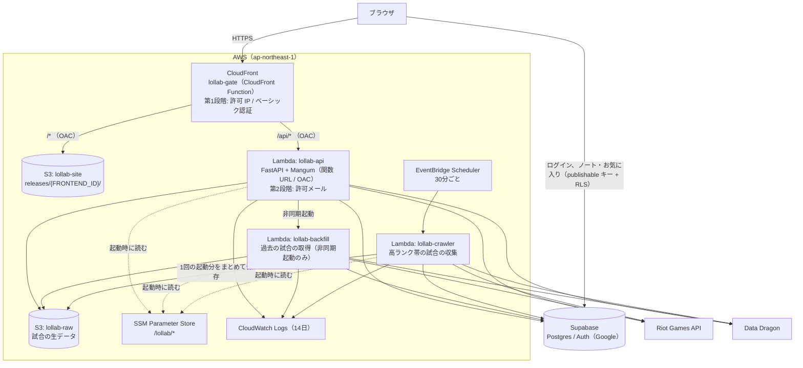
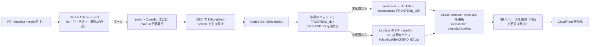

# LoL Lab のシステム構成と運用手順

画面（静的ファイル）と API（Lambda）を1つの CloudFront の下にまとめ、入口を CloudFront だけにしている。DB と認証は Supabase。AWS のリージョンは `ap-northeast-1`（東京）。

## システム構成



- フロントエンドは Next.js の静的書き出し（`output: 'export'`）。API は同じオリジンの `/api/*` で呼ぶので CORS は不要
- ノート・お気に入りはブラウザから Supabase を直接読み書きする（RLS で本人のデータだけ）
- API 呼び出しには Supabase のアクセストークンを `X-Lollab-Auth: Bearer <token>` で付ける。`Authorization` はベーシック認証と CloudFront → Lambda の署名（OAC）が使うため使わない
- 本文のある API 呼び出し（POST など）は、本文の SHA-256 を `x-amz-content-sha256` に付ける（Lambda 関数 URL の OAC の仕様。`frontend/src/lib/api/request.ts` の `apiFetch` が付ける）

## アクセス制限（2段階）

| 段階 | 場所 | 通す条件 | 設定 |
|---|---|---|---|
| 第1段階 | CloudFront Function `lollab-gate`（全パス） | 許可 IP、またはベーシック認証の一致 | `bootstrap.yaml` のパラメータ `AppGateEnabled`・`AppAllowedCidrs`・`AppBasicAuthHash` |
| 第2段階 | API の `require_allowed_user`（`/api/*`） | Supabase の JWT が有効で、メールが許可一覧にある | `AppUserGateEnabled`、SSM の `/lollab/allowed_emails` |

- 画面側のログイン必須（`AuthGate`）は `NextPublicAuthGateEnabled`（ビルド時に決まる）
- 審査期間中は第2段階だけを無効にする（`AppUserGateEnabled=false`）。一般公開時は両方を無効にする
- JWT の検証: ES256・RS256 は Supabase の JWKS、HS256 は SSM の `/lollab/supabase_jwt_secret` があるときだけ。Supabase を非対称鍵に移したら、このパラメータを消せば HS256 は拒否される（コード変更なし）
- `lollab-gate` は CloudFront Functions の JavaScript runtime 2.0 で動く。`for...of`・分割代入・スプレッド構文・クラスは使えない（使うと全リクエストが 503 になる。`gate.test.mjs` で検査している）

## 構成ファイル

| ファイル | 内容 | 反映方法 |
|---|---|---|
| `infra/bootstrap.yaml` | GitHub OIDC、GitHub Actions のロール、成果物バケット、CodeBuild `lollab-deploy`、CloudFormation のサービスロール | 手動で `aws cloudformation deploy`（下記） |
| `infra/app.yaml` | S3（site・raw）、CloudFront・OAC・`lollab-gate`、Lambda 2つ・関数 URL・IAM・ロググループ | CodeBuild が自動で更新（スタック `lollab-app`） |
| `infra/functions/gate.js` | `lollab-gate` のコード。デプロイ時に `app.yaml` に埋め込む | 同上 |
| `buildspec.yml` | CodeBuild のビルドとデプロイの手順 | 同上 |
| `.github/workflows/ci.yml` | テストと、`main` のときの CodeBuild の起動 | GitHub Actions |

## CI/CD



- **ID の決め方**: `FRONTEND_ID` は `frontend/` の中身・`NEXT_PUBLIC_*`・`buildspec.yml` から、`BACKEND_ID` は ZIP に入れる `backend/` の中身・`buildspec.yml` から作る。同じ ID の成果物が S3 にあれば、その側のビルドと配置を省く。変更のない側はスタックの更新も起きない
- **所要時間の目安**: 両方ビルドで約3分半、片方だけで1〜2分、変更なしで約30秒。CodeBuild の無料枠は月100分（arm1.small）
- **失敗時**: スタックの更新に失敗すると CloudFormation が自動で元に戻し、CloudFront は前のリリースを配信したまま
- **検査とデプロイの分担**: 検査は PR の時点だけで行う。GitHub の Rulesets（`protect-long-lived`）で `main`・`develop` に「PR 必須」「`Frontend Checks`・`Backend Checks` の成功必須」「force push 禁止」「削除禁止」を設定している。PR の検査はマージ後の状態（`refs/pull/<番号>/merge`）に対して行われ、`main` に入るのは `develop` からの PR だけなので、マージ後の `main` は検査済みの内容と同じになる。`main` への push ではデプロイだけを行う
  - 「ブランチが最新であること必須（Require branches to be up to date）」は設定しない。PR のマージで `main` にできるマージコミットが `develop` に入らないため、`develop` → `main` の PR が常に古い扱いになり、`develop` への直接の更新は「PR 必須」で拒否されてマージできなくなる
- **手動実行**: GitHub の「Actions」→「CI」→「Run workflow」で `main` を選ぶと、検査と並行してデプロイを行う。AWS のロールは `main` からしか引き受けられない
- CodeBuild を直接起動することもできる（ブランチの動作確認用。push 済みのコミットが必要）

```powershell
aws codebuild start-build --profile lollab --region ap-northeast-1 --project-name lollab-deploy --source-version <コミット SHA>
```

## 運用手順

前提: AWS CLI v2 と IAM Identity Center のプロファイル `lollab`。期限切れなら `aws sso login --profile lollab`。PowerShell では、テンプレートを読む前に `$env:AWS_CLI_FILE_ENCODING = 'UTF-8'` を実行する（しないと `'cp932' codec can't decode` になる）。

### アクセス制限を変える（許可 IP・ベーシック認証・有効／無効）

1. ベーシック認証を変える場合はハッシュを作る（`ユーザー名:パスワード` を入力する）
   ```powershell
   $pair = Read-Host 'ユーザー名:パスワード を入力'
   $b64  = [Convert]::ToBase64String([Text.Encoding]::UTF8.GetBytes($pair))
   $hash = [Security.Cryptography.SHA256]::Create().ComputeHash([Text.Encoding]::UTF8.GetBytes("Basic $b64"))
   ([BitConverter]::ToString($hash) -replace '-','').ToLower()
   Remove-Variable pair, b64
   ```
2. 変える値だけを指定して bootstrap を更新する（指定しない値は前回のまま）
   ```powershell
   aws cloudformation deploy --profile lollab --region ap-northeast-1 `
     --template-file infra/bootstrap.yaml --stack-name lollab-bootstrap `
     --capabilities CAPABILITY_NAMED_IAM `
     --parameter-overrides AppAllowedCidrs=203.0.113.10/32 AppBasicAuthHash=<64文字>
   ```
3. CodeBuild を起動する（上の「手動実行」）。CodeBuild の環境変数として `app.yaml` に渡される

| 目的 | 指定するパラメータ |
|---|---|
| 許可 IP を変える | `AppAllowedCidrs`（カンマ区切りの CIDR） |
| ベーシック認証を変える | `AppBasicAuthHash` |
| 審査期間（第2段階だけ無効） | `AppUserGateEnabled=false` |
| 一般公開（両方無効） | `AppGateEnabled=false AppUserGateEnabled=false NextPublicAuthGateEnabled=false` |

### 秘密情報を変える（SSM Parameter Store）

| 名前 | 型 | 読む関数 |
|---|---|---|
| `/lollab/riot_api_key` | SecureString | api, backfill |
| `/lollab/supabase_key` | SecureString（`sb_secret_...`） | api, backfill |
| `/lollab/supabase_url` | String | api, backfill |
| `/lollab/allowed_emails` | StringList | api |
| `/lollab/supabase_jwt_secret` | SecureString（Legacy JWT secret。任意） | api |

1. コンソールの Parameter Store で値を更新する（シェルの履歴に残さないため）。階層は「標準」
2. Lambda は起動時にだけ読む。すぐ反映するには、同じコードで関数を更新して実行環境を入れ替える
   ```powershell
   $key = aws cloudformation describe-stacks --profile lollab --region ap-northeast-1 --stack-name lollab-app `
     --query "Stacks[0].Parameters[?ParameterKey=='LambdaCodeKey'].ParameterValue" --output text
   $bucket = aws cloudformation describe-stacks --profile lollab --region ap-northeast-1 --stack-name lollab-bootstrap `
     --query "Stacks[0].Outputs[?OutputKey=='ArtifactBucketName'].OutputValue" --output text
   foreach ($fn in 'lollab-api','lollab-backfill','lollab-crawler') {
     aws lambda update-function-code --profile lollab --region ap-northeast-1 --function-name $fn --s3-bucket $bucket --s3-key $key | Out-Null
   }
   ```

### Riot の Production キーに切り替える

1. SSM の `/lollab/riot_api_key` を Production キーにする
2. `infra/app.yaml` のパラメータ `ApiRateLimits`・`BackfillRateLimits`・`CrawlerRateLimits` の既定値を、合計がキーの上限以内になるように変えて `main` にマージする（Personal キーの上限は `20:1,100:120`、Production キーは `500:10,30000:600`）

### ローカル開発

- `frontend/.env.local`: `NEXT_PUBLIC_SUPABASE_URL`、`NEXT_PUBLIC_SUPABASE_ANON_KEY`（publishable キー）、`NEXT_PUBLIC_BACKEND_URL=http://localhost:8000`、`NEXT_PUBLIC_AUTH_GATE_ENABLED=false`
- `backend/.env`: `SUPABASE_URL`、`SUPABASE_KEY`（secret キー）、`RIOT_API_KEY`、`CORS_ORIGINS=["http://localhost:3000"]`。`SSM_PARAMETER_PATH` は設定しない（`.env` を使う）
- 起動: `frontend` で `npm run dev`、`backend` で `uvicorn main:app --reload`
- ローカルでは Backfill は同じプロセスで動き（`BACKFILL_MODE=inline`）、生データは `RAW_BUCKET` が無ければ Supabase Storage に保存される

### クローラー（試合の自動収集）

- `lollab-crawler` を EventBridge Scheduler が30分ごとに起動する。JP のエメラルド以上のプレイヤーの直近のソロランクの試合を集め、ランク帯（`rank_tier`）を付けて保存する。仕様は `.kiro/specs/match-crawler/`
- 結果は起動ごとに1行の JSON で CloudWatch Logs の `/aws/lambda/lollab-crawler` に出る（`stop_reason`・`matches_saved`・`riot_requests` など）
- Riot API の上限は関数ごとに分け合う（`lollab-api` 6:1,30:120、`lollab-backfill` 4:1,20:120、`lollab-crawler` 8:1,45:120。`app.yaml` のパラメータ）
- 停止・再開: bootstrap のパラメータ `AppCrawlerEnabled=DISABLED`（再開は `ENABLED`）で bootstrap を更新し、CodeBuild を起動する。停止中は起動されない
- DB に残すクローラーの試合は直近10万件（検索済みサモナーが参加した試合は除く）。超えた分は起動ごとに古い順に削除される

### DB のマイグレーション

`supabase/migrations/` のファイルを、Supabase の SQL Editor でファイル名の順に実行する。定義は `.kiro/specs/database/design.md` で管理する。

## トラブルシューティング

| 症状 | 原因と対処 |
|---|---|
| 全ページが 503（`X-Cache: FunctionExecutionError`） | `lollab-gate` の実行エラー。`aws cloudfront test-function` で原因を確認する。runtime 2.0 で使えない構文が多い |
| `ROLLBACK_COMPLETE` でデプロイできない | 初回作成の失敗。`aws cloudformation delete-stack --stack-name lollab-app` で消してから再実行する（S3 の `lollab-raw` は削除されずに残るので、その場合は手動で消すか残す） |
| CodeBuild が `AccessDenied` | `bootstrap.yaml` のロールに権限を足し、bootstrap を更新する（CodeBuild は自分の bootstrap を更新できない） |
| ブラウザでベーシック認証が毎回出る | IPv6 で接続していて許可 IP（IPv4）と一致しない。ベーシック認証で入るか、IPv6 の /64 を `AppAllowedCidrs` に加える |
| 存在しない URL で XML の Access Denied が出る | 仕様（404 ページは未設定）。一般公開時の SEO 対応で作り直す。CloudFront の CustomErrorResponses は `/api/*` の 403・404 も置き換えてしまい、viewer-response の関数はオリジンが 400 以上を返すと動かないため |

## コスト方針

- 商用リリースまで AWS の Always Free の範囲で動かす（月の予算上限は500円）
- 使わないもの: VPC・NAT Gateway・常時起動のサーバー・Provisioned Concurrency・AWS WAF・Secrets Manager・CloudFront KeyValueStore・KMS のカスタマー管理キー・CloudFront の標準ログ
- 通知: AWS Budgets（`lollab-zero-spend` は1セントでも費用が出たら、`My Monthly Cost Budget` は月 $1）と、請求設定の「無料利用枠の使用アラート」
- 主な無料枠: Lambda（月100万リクエスト・40万 GB 秒）、CloudFront（月1TB・1,000万リクエスト）、CodeBuild（月100分）、CloudWatch Logs（5GB）。S3 は無料枠の対象外の部分があるが、保存量が小さい間は数円以内
- ログの保存は14日。S3 `lollab-site` は CodeBuild が今回と直前のリリース以外を消す。成果物バケットの Lambda の ZIP（`lambda/`）は CodeBuild が今回と直前以外を消し、テンプレート（`templates/`）は30日で自動削除
